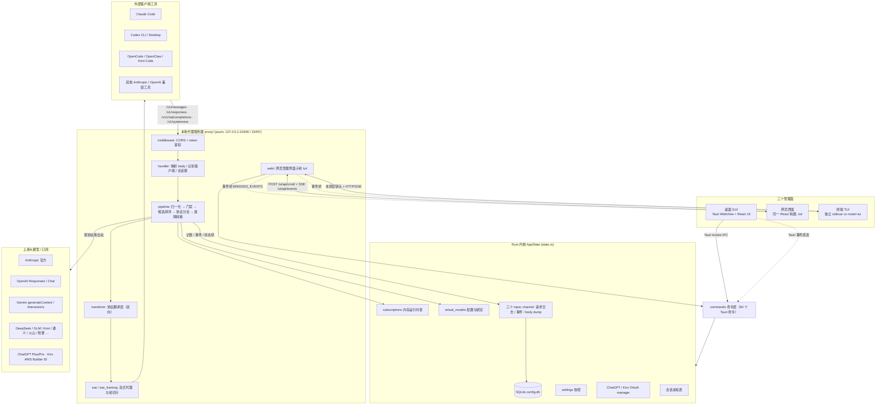
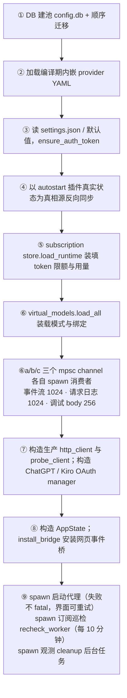
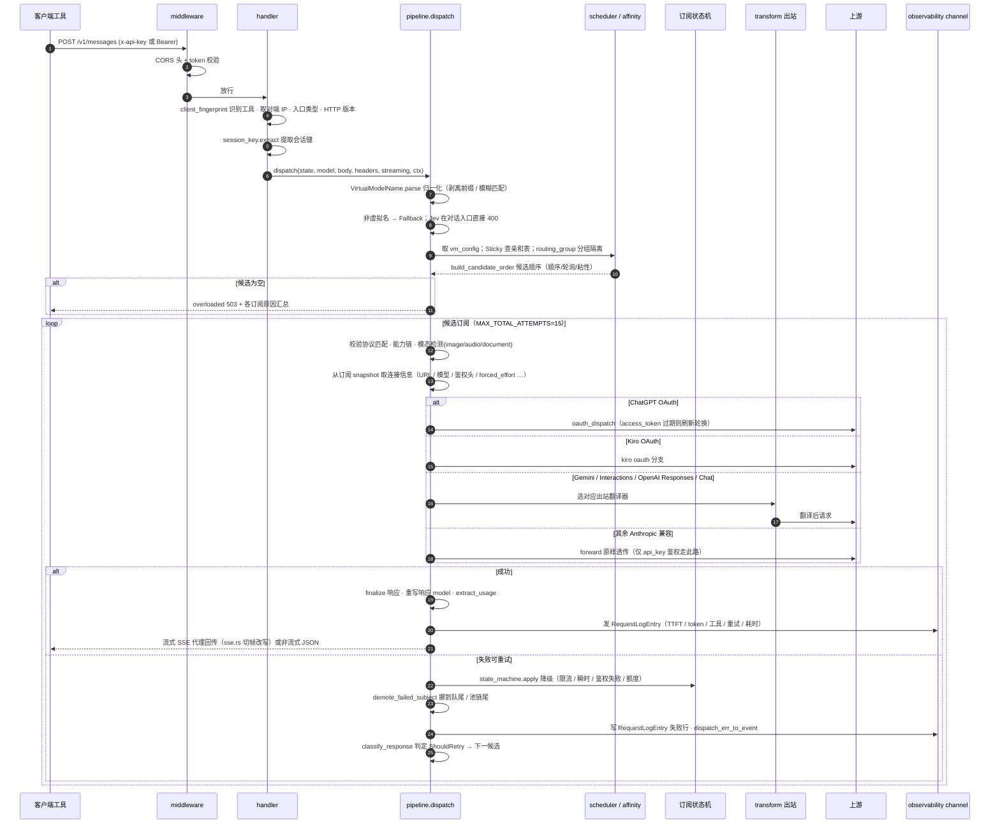
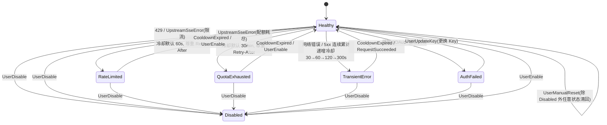

# cc-router v6.5.0 源码架构分析报告

> 适用代码基线：仓库根 `E:\cc-router-main`，`package.json` / Cargo 版本 `6.5.0`。
> 本文是**源码导读与架构分析**，面向已具备 Tauri / Rust / React 基础、需要快速建立全局心智模型的读者。
> 阅读方式：第 1–6 章建立全局图；第 7–10 章是调度与协议核心；第 11–13 章是三端界面；第 14–17 章为横切能力、同步清单与二次深入指针。
> 证据口径：模块职责来自源码文件头注释、`pub fn / pub struct / pub enum` 清单与主流程通读；超大文件（100KB 级）按"模块边界 + 关键函数 + 单测锁定语义"归纳，未逐字符展开，相关文件在第 17 章列为二次深入指针。
>
> **魔改声明**：本报告分析的 cc-router 为 **cc** 的二次开发分支（魔改 / fork），原作者 **cc**（[@//cc/](https://github.com/finch-xu/cc-router)）。本人仅为二次开发者，并非原作者。

---

## 目录

- [1. 项目定位与一句话架构](#1-项目定位与一句话架构)
- [2. 技术栈与代码规模（实盘统计）](#2-技术栈与代码规模实盘统计)
- [3. 仓库目录索引](#3-仓库目录索引)
- [4. 总体分层架构](#4-总体分层架构)
- [5. 启动装配链路（bootstrap）](#5-启动装配链路bootstrap)
- [6. 一次请求的完整生命周期](#6-一次请求的完整生命周期)
- [7. 调度模型：虚拟模型、范式、路由策略与候选排序](#7-调度模型虚拟模型范式路由策略与候选排序)
- [8. 订阅状态机、冷却、降级与巡检复活](#8-订阅状态机冷却降级与巡检复活)
- [9. 协议体系：入口、出口与翻译层矩阵](#9-协议体系入口出口与翻译层矩阵)
- [10. 数据持久化：SQLite、配置文件、证书与备份](#10-数据持久化sqlite配置文件证书与备份)
- [11. 命令层与三条管理通道（桌面 / 网页 / TUI）](#11-命令层与三条管理通道桌面--网页--tui)
- [12. 前端（React 19）架构](#12-前端react-19架构)
- [13. TUI sidecar 独立 crate 架构](#13-tui-sidecar-独立-crate-架构)
- [14. 横切能力](#14-横切能力)
- [15. 前后端手工同步清单（改一处必须同步另一处）](#15-前后端手工同步清单改一处必须同步另一处)
- [16. 关键设计约束与安全要点](#16-关键设计约束与安全要点)
- [17. 二次深入阅读地图（超大文件分级）](#17-二次深入阅读地图超大文件分级)
- [18. 附录](#18-附录)

---

## 1. 项目定位与一句话架构

**cc-router 是一个本地运行的大模型订阅聚合网关桌面应用**：把用户手里零散的 API Key、ChatGPT/Kiro 订阅、各家兼容端点，聚合成一组对外统一的"虚拟模型"，供 Claude Code、Codex、OpenCode、OpenClaw、Kimi Code、Cherry Studio 等编程工具以 Anthropic Messages / OpenAI Responses / OpenAI Chat Completions 协议接入。

核心运行形态：

- 本地代理监听 `127.0.0.1:23456`（HTTP，默认）/ `23457`（HTTPS，可选），对外暴露 4 个对话入口 + 模型清单 + 健康检查。
- 收到请求 → 归一化虚拟模型名 → 在绑定该虚拟模型的订阅列表里按策略选候选 → 按订阅所属协议族翻译请求 → 出站到上游 → 把上游响应翻译回客户端协议 → 流式代理回传，全程记账、记日志、驱动订阅健康状态机。
- 同一套后端服务三个管理面：**桌面 GUI**（Tauri + React，主形态）、**网页管理界面**（代理端口上的 `/ui/`，可选开启）、**终端 TUI**（独立 sidecar 二进制 `cc-router-tui`，经本机密钥走网页 API）。

一句话架构：

> **React 前端（桌面 / 网页同一份构建）通过命令层操作一个共享的 Rust 内核；Rust 内核同时内嵌一个 axum 代理服务器，负责协议翻译、多订阅调度、故障转移、记账与观测；TUI 是不共享内核代码、只经 HTTP/SSE 连接内核的独立终端客户端。**

### 1.1 三类流量，互不混淆

| 流量类别 | 路径 | 说明 |
| --- | --- | --- |
| **代理业务流量** | 客户端工具 → `127.0.0.1:23456/v1/...` → 上游大模型 | 协议翻译 + 调度 + 故障转移，是产品主路径 |
| **管理命令流量** | 前端 → Tauri IPC（桌面）或 `/ui/api/cmd/<name>`（网页 / TUI）→ 命令层 → `AppState` / SQLite | 增删改订阅、查统计、改设置、测试连接等 |
| **管理事件流量** | 内核 `emit` → broadcast → 网页 SSE `/ui/api/events` / TUI SSE；桌面直接 Tauri 事件 | 订阅状态变化、配额触顶、路由尝试开始/结束、代理重启、更新进度 |

---

## 2. 技术栈与代码规模（实盘统计）

统计口径：排除 `node_modules/`、`dist/`、`.git/`、`src-tauri/target/`、`.screenshots/`；数字为本报告生成时在仓库内实测。

### 2.1 技术栈

**前端（`src/`）**

- React `19.2.8`、react-router `8.3.1`、`@tanstack/react-query 5.102`（数据获取与缓存）
- Radix UI 全家桶 + Tailwind CSS 4；`recharts 3.10` 统计图表；`@uiw/react-codemirror` 设置编辑器；`@lobehub/icons` 品牌图标；`html-to-image` / `jspdf` / `jsbarcode` / `qrcode.react` 小票导出；`@dnd-kit` 拖拽排序
- 构建：Vite `8.2.4`、TypeScript `7.0.2`；`vite.config.ts` 使用 `base: "./"`，同一份 `dist` 同时支持 `tauri://localhost` 与网页 `/ui/` 前缀

**后端主 crate（`src-tauri/src/`）**

- Tauri 2（`tray-icon` 插件）、Rust 1.90、`tokio`（full）、`axum 0.8`（http2/macros）、`hyper 1`、`reqwest 0.13`
- `axum-server` + `rustls 0.23` + `rcgen`（本地自签 HTTPS）；`sqlx 0.9`（SQLite / tokio / chrono）
- `jsonschema`（厂商 YAML 校验）；`tracing` 三件套；`argon2` + `chacha20poly1305` + `zeroize`（备份口令加密）；`if-addrs`（局域网地址枚举）
- release profile：`panic=abort`、LTO、`codegen-units=1`、`opt-level=s`、strip

**TUI sidecar crate（`src-tauri/crates/cc-router-tui/`）**

- 独立 workspace 成员，`ratatui` + `crossterm` + `tokio` + `reqwest`；**不依赖主 crate 代码**，只经 HTTP/SSE 连桌面 app；主 crate 用契约测试核对命令名、事件名与 DTO JSON 结构。

### 2.2 规模实数

| 层 | 文件数 | 代码体积 | 说明 |
| --- | --- | --- | --- |
| 前端 `src/`（全部源码与静态资源） | 203 | ≈ 1914.0 KB | 124 `.tsx` + 64 `.ts` + 5 `.css` + 6 `.json`（4 语字典 + 2 用例表）+ 2 `.png` + 1 `.md` + 1 `.txt`；其中 i18n 字典 97–129 KB/份 |
| 后端主 crate `src-tauri/src/`（`.rs`） | 127 | ≈ 2242 KB | 含 `pipeline.rs`、`responses_common.rs` 等 100KB 级大文件 |
| TUI crate `crates/cc-router-tui/`（`.rs`） | 42（src）+ 1（tests/ui.rs） | ≈ 1301 KB | 含 `i18n.rs` 136KB、`app.rs`、`runtime.rs`、`pages/subscriptions.rs` |
| SQLite 迁移 `src-tauri/migrations/` | 28 个 `.sql` | — | 手写顺序迁移，`_schema_version` 表记录已应用版本 |
| 内置厂商 `src-tauri/providers/` | 27 个 `.yaml` + `_schema.json` | — | 构建期编译进二进制 |

### 2.3 关键配置文件

| 文件 | 职责 |
| --- | --- |
| `package.json` | 前端依赖、脚本（`dev/build/preview/tauri/tauri:dev/tauri:build`）与 `check:i18n / check:schedule / check:onboarding` 校验脚本 |
| `vite.config.ts` | `base: "./"`、`@` → `./src` 别名；dev server 固定 `127.0.0.1:1420`（strictPort，HMR 1421）；watch 忽略 `src-tauri/**` |
| `index.html` | 首帧同步脚本先读 localStorage `cc-router-theme` / `cc-router-ui-theme`，提前打 `data-theme` / `data-art` 避免闪屏；挂载点 `#root`，入口 `/src/main.tsx` |
| `start-dev.bat` | 检查 pnpm → 缺 `node_modules` 则 install → `pnpm tauri:dev` |
| `src-tauri/tauri.conf.json` | productName `cc-router`、identifier `com.cc-router.desktop`；窗口 1360×840（最小 1120×720）、初始 `visible:false`；CSP 限定 self/ipc/更新源；托盘图标；`externalBin: binaries/cc-router-tui`；updater 指向 GitHub Releases `latest.json`；`beforeDevCommand` 先跑 `build-tui-sidecar.mjs` 再 `pnpm dev` |
| `src-tauri/Cargo.toml` | workspace 成员 = 主 crate + TUI crate；主 crate name `cc-router`、lib name `cc_router_lib`、`publish=false` |
| `src-tauri/build.rs` | 构建期内嵌厂商 YAML 与发版说明；补 sidecar 0 字节占位保证 `cargo test` 可编；调 `tauri_build::build()` |
| `src-tauri/src/main.rs` | 仅一行 `cc_router_lib::run();`；release 下 `windows_subsystem="windows"` |

---

## 3. 仓库目录索引

### 3.1 前端 `src/`

```
src/
├── main.tsx                 # 应用入口：平台属性、QueryClient、Provider 嵌套、样式加载
├── App.tsx                  # 路由表、六个事件桥 hook、引导/网页登录门禁
├── types.ts                 # 与后端 DTO 一一对应的全部 TS 类型 / 枚举（≈40KB）
├── styles.css               # 主样式（手绘 sketch 配色与基础规则，≈128KB）
├── receipt-fonts.css        # 小票主题字体（≈160KB）
├── fonts.ts / vite-env.d.ts
├── runtime/                 # 双后端运行时抽象（桌面 Tauri IPC / 网页 HTTP+SSE 同一接口）
│   ├── index.ts            # 检测 window.__TAURI_INTERNALS__ 决定 desktop / web
│   ├── types.ts            # 统一 Runtime 接口 + AUTH_REQUIRED_EVENT
│   ├── tauri.ts            # 桌面实现：invoke / listen / 窗口三键 / 对话框 / 剪贴板
│   └── web.ts              # 网页实现：/ui/api 前缀、CSRF 头、单例 EventSource、401 登出
├── api/
│   └── tauri.ts            # api 对象封装全部后端命令，签名与 commands 层一一对应
├── hooks/                  # React Query 封装 + 事件桥 + 主题/时钟/更新器（17 个文件，见 §12.4）
├── routes/                 # 页面组件（28 个 tsx + 1 个表单 hook，App.tsx 注册 18 条路由，见 §12.3）
├── components/             # 复用组件（layout / onboarding / receipts / stats / schedule / sketch / win2k / release-notes / ui 等，见 §12.6）
├── lib/                    # 纯函数与静态元数据（虚拟模型元数据、槽位、配额、别名、分时段求值镜像等）
├── i18n/                   # 四语字典 + 回退规则 + 系统语言解析（zh / zh-Hant / en / ja）
├── themes/                 # 三套主题注册与 classic / plain / win2k 样式
├── utils/                  # 小票导出（PNG / PDF / HTML）等通用工具
└── assets/                 # 静态资源
```

### 3.2 后端主 crate `src-tauri/src/`

```
src-tauri/src/
├── main.rs                 # 入口，调 cc_router_lib::run()
├── lib.rs                  # Tauri 插件注册、setup()、bootstrap()、invoke_handler（84 命令）
├── state.rs                # AppState：全部运行时共享状态的聚合（见 §4.2）
├── error.rs                # AppError 枚举 + AppErrorDto {code,message}，HTTP 状态映射
├── window.rs               # 启动时按显示器可用区自适应窗口几何
├── runtime_file.rs         # app_data_dir/runtime.json：端口、本机密钥、系统语言，供 TUI 发现连接
├── updater_source.rs       # 国际(GitHub) / 中国大陆(阿里云 OSS) 双更新源 manifest URL
├── tui_contract.rs         # 主 crate ↔ TUI 契约测试：真实 DTO JSON 灌入 TUI 手写结构体
├── tui_install.rs         # TUI 二进制加入 PATH 的三平台实现（符号链接 / 用户 PATH / 复制）
├── zh_hant_check.rs        # 繁中文案一致性检查（编译期 / 测试）
│
├── db/
│   ├── mod.rs              # SQLite 连接池(WAL)、28 个顺序迁移、版本表、存储统计、容量守卫
│   └── paths.rs            # app_data_dir 解析
├── settings/
│   ├── mod.rs              # settings.json 加载/默认/保存、auth_token 生成
│   └── model.rs            # Settings / SettingsPatch / ProxyMode 全部字段定义
├── provider/               # 内置厂商预设（编译期内嵌 YAML）
│   ├── model.rs            # Provider / Endpoint / AuthType(7) / EndpointProtocol / UrlParam / LocalizedText
│   ├── loader.rs           # 加载 EMBEDDED_PROVIDERS、jsonschema + 语义校验
│   ├── schema.rs           # _schema.json 编译内嵌
│   └── url_template.rs     # {model}/{api_key} 保留字与用户参数占位符解析
├── subscription/            # 订阅运行时、持久化、配额、分时段、模型/余额发现、巡检
│   ├── model.rs            # SubscriptionRow / SubscriptionRuntime / 状态枚举 / OAuthMetadata / 槽位 / 余额快照
│   ├── store.rs            # SQLite 读写、模型缓存、余额缓存、配额用量、模型池链
│   ├── state_machine.rs    # 健康状态转换、冷却定时器、事件
│   ├── quota.rs            # TokenQuotas / QuotaUsage / 周期(日/周/月/累计) 纯逻辑
│   ├── schedule.rs         # 分时段周窗口规则与求值（与前端共享用例表）
│   ├── snapshot.rs          # 模板/自定义 → 连接快照（URL、路径、鉴权头、必需头）
│   ├── model_discovery.rs  # /v1/models 模型列表探测与缓存，按协议族解析 envelope
│   ├── balance_discovery.rs# 余额自动发现
│   ├── ping.rs             # 最小 prompt 探测
│   ├── last_error.rs       # 最近错误结构化记录（中文落库文本 ↔ DTO 往返单测）
│   └── recheck_worker.rs   # 每 10 分钟复活异常订阅的后台巡检
├── virtual_model/          # 虚拟模型命名空间与绑定持久化
│   ├── model.rs            # VirtualModelName(11) / CapabilityCategory / RoutingMode / 别名解析 / 范式
│   ├── scheduler.rs         # 候选顺序构建（顺序 / 轮询 / 粘性亲和 + 分时段可调度判定）
│   ├── affinity.rs         # 会话→订阅亲和表（内存态，不持久化）
│   ├── store.rs            # virtual_model_config / virtual_model_bindings 读写
│   └── mod.rs
│
├── proxy/                  # 本地代理服务器与调度管线（产品主路径）
│   ├── mod.rs
│   ├── server.rs           # ProxyHooks、build_router（四入口 + models + health + 网页子树）
│   ├── handler.rs          # 各入口 handler：解析 body、识别客户端、构造 ClientContext、进 pipeline
│   ├── middleware.rs        # CORS 层、代理 token 鉴权层
│   ├── listeners.rs        # ProxyConfig 快照、listener 绑定、restart_pending 判定
│   ├── controller.rs        # 代理生命周期：重建 listener、优雅关停、失败回滚
│   ├── pipeline.rs         # 调度主循环：归一化 → 门禁 → 候选循环 → 协议分支 → 记账/状态机（≈103KB）
│   ├── retry.rs            # 上游错误分类、ShouldRetry、Retry-After 解析
│   ├── affinity.rs 见上      # （会话亲和在 virtual_model/affinity.rs）
│   ├── session_key.rs      # 纯函数提取会话键（systemone 只认 x-session-id）
│   ├── client_fingerprint.rs# 识别 Claude Code / Codex CLI / Zed / Cursor / OpenCode / SDK 等
│   ├── extractors.rs       # HttpVersion 提取器
│   ├── forward.rs          # Anthropic 透传出站头组装、客户端头白名单转发
│   ├── sanitize.rs         # 清洗回灌消息中上一轮翻译层包装的 thinking block
│   ├── sse.rs              # 流式代理：按 \n\n 切帧、首帧 message_start 改写 model、TTFT 计量
│   ├── sse_framing.rs      # SSE 空行帧边界识别（LF `\n\n` / CRLF `\r\n\r\n`，取最早出现）
│   ├── tool_log.rs         # 工具调用统计字段（取不到一律 None/0，不影响日志投递）
│   ├── effort_log.rs        # 思考强度三格（客户端 / 实际 / 来源）记录
│   ├── overloaded.rs       # 全部订阅不可用时的 503 汇总响应
│   ├── systemone.rs         # Jev 专用多上游网关：原样透传、只调度 systemone 订阅
│   ├── upstream.rs          # 上游响应抽象（非流式 / 流式 + Retry-After）
│   ├── oauth_dispatch.rs / gemini_dispatch.rs / gemini_interactions_dispatch.rs
│   ├── openai_responses_dispatch.rs / openai_chat_completions_dispatch.rs
│   ├── transform/           # 协议翻译层（入站 + 出站，详见 §9.3）
│   └── web/                # 网页管理界面子树（gate / auth / api / events / assets / local_pass）
│
├── oauth/                  # ChatGPT Plus/Pro、Kiro(AWS Builder ID) 订阅 OAuth
│   ├── chatgpt.rs          # Device Code 流程、refresh 轮换、per-subscription 互斥锁
│   ├── chatgpt_models.rs   # ChatGPT 模型映射
│   ├── kiro.rs             # Social / Idc 两种凭据、AWS SSO OIDC Device Flow、refresh
│   └── mod.rs
├── observability/          # 观测与持久化消费者
│   ├── mod.rs
│   ├── request_log.rs      # 请求日志批量落库 + 三张日聚合表 + 配额记账（≈50KB）
│   ├── events.rs           # 三类事件（状态机 / 系统错误 / 配额触顶）批量落库
│   ├── body_dump.rs        # debug_mode 三段请求/响应体落盘
│   ├── cleanup.rs          # 旧日志定时清理、DB 容量守卫、VACUUM
│   └── logger.rs           # tracing 初始化
├── tls/                    # 本地自签 CA + leaf 证书
│   ├── mod.rs / ca.rs / leaf.rs / config.rs / store.rs
├── tray/                   # 系统托盘与窗口关闭拦截
│   ├── mod.rs / menu.rs / strings.rs
├── backup/                 # 配置导出/导入 + 口令加密
│   ├── mod.rs / crypto.rs / export.rs / format.rs / import.rs
├── integrations/
│   ├── mod.rs
│   └── claude_code.rs      # ~/.claude/settings.json 读写、同步状态探测、原子写与备份
├── release_notes/
│   ├── mod.rs              # 内嵌发版说明装载、已读标记
│   └── markdown.rs         # Markdown 子集严格解析器（构建期与运行期共用）
└── commands/               # Tauri 命令层（84 个命令函数，21 个文件，详见 §11.1）
```

### 3.3 TUI crate `src-tauri/crates/cc-router-tui/src/`

```
cc-router-tui/src/
├── main.rs                 # 参数解析 → 发现 runtime.json → 连接 → 进备用屏幕界面
├── lib.rs                  # 模块清单
├── runtime.rs              # 主循环：键盘 / 250ms 定时器 / SSE / 后台 HTTP 汇成 Action；双档渲染；断线退避
├── app.rs                  # 应用状态 + 外壳（标签栏 / 底栏 / 帮助 / toast），纯逻辑可 TestBackend 测试
├── action.rs               # Action / Cmd / Fetch / Mutation / WizardCmd 枚举
├── store.rs                # 全局只读数据缓存
├── theme.rs / fx.rs / format.rs / popup.rs / secret.rs
├── i18n.rs                 # 四语 Strings（≈136KB）
├── client/                 # 与桌面 app 通信（不含界面）
│   ├── mod.rs              # commands 常量表、events 常量表、测试假后端
│   ├── http.rs            # POST /ui/api/cmd、GET /ui/api/events、本机通行头、ClientError
│   ├── discovery.rs       # 数据目录 / 平台 / runtime.json 读取
│   ├── dto.rs              # 手写视图结构体（契约测试保证与后端 JSON 兼容）
│   └── sse.rs             # SSE 帧解析
├── pages/                  # 五个 Component 页面：overview / subscriptions / virtual_models / live / logs（+ draft）
├── wizard/                 # 新建订阅向导（basics → slots；custom 单页；纯数据/纯函数拆分）
└── widgets/                # 跨页面小部件：keybar / picker / toast / badge / confirm / detail / form / gauge / help
```

### 3.4 仓库其他目录

| 路径 | 内容 |
| --- | --- |
| `docs/` | 五份设计方案：`capability-redefinition-plan.md`（能力分类语义重定义）、`failover-smooth-plan.md`（池订阅丝滑故障转移）、`pool-subscription-page-plan.md`（池专属添加订阅页）、`responses-api-probe.md`（Responses API 实测报告）、`routing-mode-portal-plan.md`（路由模式门户） |
| `release-notes/<版本>/` | 每版本 `zh.md / en.md / ja.md / meta.json`（新版本另含 `zh-Hant.md`），构建期内嵌并校验，缺 `zh.md` 报错 |
| `scripts/` | `build-tui-sidecar.mjs`、`check-i18n.mjs`、`check-slot-schedule.mjs`、`check-onboarding.mjs`、`collect-receipt-fonts.mjs`、`generate-latest-json.mjs`、`set-version.mjs`、`make-macos-icon.mjs`、`release-body.mjs` 等 |
| `.claude/skills/` | `new-provider`（新增厂商流程）、`release-prep`（发版准备）两个技能说明 |
| `.github/workflows/release.yml` | 跨平台构建、双源（GitHub Release + OSS）发布、签名与 manifest 生成 |
| `src-tauri/tests/` | `integrations_claude_code.rs`、`live_chat_completions_probe.rs`、`live_responses_probe.rs`、`live_systemone_probe.rs` 等集成 / 活体探测测试 |
| `cc-router使用教程.md` | 用户操作手册（Windows 配置与使用），非源码架构文档 |

---

## 4. 总体分层架构

### 4.1 组件关系总览（Mermaid）



### 4.2 内核共享状态 `AppState`（`src-tauri/src/state.rs`）

| 字段 | 类型 / 职责 |
| --- | --- |
| `db` | SQLite 连接池 |
| `providers` | `Arc<HashMap<ProviderId, Provider>>`，编译期内嵌的厂商预设 |
| `subscriptions` | `Arc<RwLock<HashMap<Uuid, Arc<RwLock<SubscriptionRuntime>>>>>`，订阅内存运行时表（行数据 + 状态 + 配额用量 + 模型/余额缓存） |
| `virtual_models` | 虚拟模型配置（模式、有序订阅绑定、轮询索引） |
| `settings` | 当前设置快照（`RwLock<Settings>`） |
| `http_bound_port` / `https_bound_port` | 实际绑定端口（可能因占用顺延） |
| `proxy` | `ProxyController`，代理生命周期管理 |
| `request_log_tx` / `event_log_tx` / `body_dump_tx` | 三个独立 mpsc 生产者，分别对应日志、事件、调试 body 消费者 |
| `http_client` | 生产出站客户端（600s 空闲超时） |
| `probe_client` | 探测客户端（10s 连接 / 30s 总超时，仅测试连接与巡检） |
| `chatgpt_oauth` / `kiro_oauth` | 两个 OAuth manager |
| `app_handle` | Tauri 句柄（发事件、托盘、窗口） |
| `session_affinity` | Sticky 会话亲和表（内存态） |
| `web_sessions` / `web_login_guard` | 网页界面会话表与登录按 IP 限流守卫 |
| `ui_events` | 跨管理面 broadcast 事件总线 |
| `local_secret` | 本次进程本机通行密钥（仅内存 + runtime.json，见 §16.4） |

`AppState::local_base_url()` 选择顺序：HTTP 端口 → HTTPS 端口 → `settings.proxy_port`，作为客户端应连接的唯一真相 URL。

### 4.3 分层职责边界

1. **代理层（`proxy/`）**：无界面、不直接读写 UI；读 `AppState` 决定调度，产出 `RequestLogEntry` / `EventEntry` 投递 channel。
2. **命令层（`commands/`）**：桌面 IPC、网页 HTTP、TUI HTTP 三条通道复用同一批命令函数；只做参数校验、状态读写、调业务模块、返回 DTO。
3. **业务领域层**：`subscription/`、`virtual_model/`、`provider/`、`oauth/`、`settings/`、`backup/`、`tls/`、`release_notes/`、`observability/`、`integrations/`，命令层与代理层都向下调用。
4. **前端 / TUI**：不持有业务真相，全部经命令 / 事件从内核取数；纯展示、本地草稿、表单校验与界面动画。

---

## 5. 启动装配链路（bootstrap）

入口 `src-tauri/src/lib.rs` → `run()`：注册 Tauri 插件（shell / dialog / clipboard-manager / updater / autostart / os；release 下额外注册 `single-instance`），`setup()` 内顺序执行：

1. **可观测性初始化**：`observability/logger.rs` 装配 tracing 日志。
2. **窗口几何自适应**：`window.rs` 按显示器 `work_area()` 重算首帧尺寸（配置里的宽高只是初值）。
3. **`block_on(bootstrap)`**（内核初始化，见下）。
4. **系统托盘**：`tray/mod.rs` 注册菜单、状态刷新与窗口关闭拦截。

### 5.1 `bootstrap()` 九步（`lib.rs`）



- **DB 迁移**：`db/mod.rs` 单连接顺序应用 `migrations/001…028.sql`，`_schema_version` 表记录版本；旧库（已有 `subscriptions` 但无版本表）标定为 v1 baseline；WAL 模式、`synchronous=Normal`；表重建迁移临时 `PRAGMA foreign_keys=OFF`，整段跑在同一连接上。
- **代理启动失败不致命**：`bootstrap` 把代理启动错误交给界面重试，管理面与数据层先可用。
- **事件桥 `install_bridge`**：对 `BRIDGED_EVENTS` 逐个 `listen_any`，把 Tauri emit 的 payload 原样转投 `ui_events` broadcast，供网页 SSE 与 TUI SSE 订阅（详见 §11.4）。
- `invoke_handler` 在此注册 84 个命令，命令名与前端 `api/tauri.ts`、TUI `client/mod.rs::commands`、`web/api.rs::web_commands!` 三处保持一致。

### 5.2 运行期后台任务

| 任务 | 周期 / 触发 | 职责 | 源码 |
| --- | --- | --- | --- |
| 请求日志消费者 | 攒 50 条或 5 秒 flush | 明细落 `requests`、写日聚合表、配额记账、发统计事件 | `observability/request_log.rs` |
| 事件消费者 | 批量 flush | 三类事件落 `events` 表 | `observability/events.rs` |
| 订阅巡检 `recheck_worker` | 启动立即扫一次，之后每 600 秒 | 扫描异常状态订阅逐条 `ping`，通过则触发 `UserManualReset` 复活 | `subscription/recheck_worker.rs` |
| 观测清理 `cleanup` | 每 6 小时 | 删除超 `log_retention_days` 的明细；三张日聚合表永久保留；DB 容量守卫与 VACUUM | `observability/cleanup.rs` |
| 网页 SSE 保活 | 15 秒 | `KeepAlive` 保活；连续 3 次未到事件（45s）TUI 判定断线 | `proxy/web/events.rs`、TUI `runtime.rs` |

---

## 6. 一次请求的完整生命周期

### 6.1 对话主路径时序图（Anthropic Messages 入口为例）



### 6.2 `handler.rs` 四个对话入口的分工

| 入口路径 | 入站处理 | 错误体格式 | 源码 |
| --- | --- | --- | --- |
| `POST /v1/messages` | 直接进 `pipeline::dispatch`，Anthropic 原生 | Anthropic `error` 对象 | `proxy/handler.rs::messages` |
| `POST /v1/responses` | 先 `responses_inbound::request_to_anthropic` 翻译成内部 Anthropic Messages 再进 pipeline；响应经 `response_to_responses_json` 转回 | OpenAI Responses 错误格式 | `proxy/handler.rs::responses` |
| `POST /v1/chat/completions` | 先 `chat_completions_inbound::request_to_anthropic` 翻译；响应经 `response_to_chat_json` 转回 | OpenAI Chat Completions 错误格式 | `proxy/handler.rs::chat_completions` |
| `POST /v1/systemone` | Jev 专用，`proxy/systemone.rs` 独立调度，协议原样透传不翻译；只服务 `model-jev`、只调度 systemone 协议订阅；非流式 | 复用对话路径错误分类 | `proxy/handler.rs::systemone` |

辅助入口：`GET /v1/models`（按当前范式与绑定返回虚拟模型清单）、`GET /health`（返回 `ok`）；未登记路径显式 404。

### 6.3 一次 dispatch 的关键常量与边界

| 常量 / 规则 | 值 / 语义 | 位置 |
| --- | --- | --- |
| `MAX_TOTAL_ATTEMPTS` | 15，跨订阅 × 模型的总尝试上限 | `proxy/pipeline.rs` |
| `DEFAULT_REASONING_EFFORT` | `medium`，缺省思考强度 | `proxy/pipeline.rs` |
| 候选为空 | 汇总每家不可用原因，返回 `overloaded.rs` 的 503 响应（见 §7.8） | `proxy/overloaded.rs` |
| 每次 attempt | 独立 `attempt_id`，避免日志主键冲突，Logs 页可见每次 retry 的具体错误 | `proxy/pipeline.rs` |
| `debug_mode` | 整个 dispatch 期间读一次设置；三段 body 缓存一次复用，避免循环内重复加锁 | `proxy/pipeline.rs` → `observability/body_dump.rs` |
| TTFT | 用独立 `peek_first_byte_at` 计时，不把 peek + 状态机耗时计入首 token 时延 | `proxy/sse.rs` |

### 6.4 记账与事件（异步、不阻塞响应）

- 成功 / 失败的 attempt 都构造 `RequestLogEntry` 投入 `request_log_tx`；消费者批量落 `requests` 表并刷新 `request_stats_daily` / `receipt_stats_daily` / `tool_stats_daily`，同时完成订阅配额扣减。
- 状态机迁移、配额触顶、系统错误经 `events.rs` 发对应事件；路由尝试开始 / 结束事件经 `route_attempt_started / route_attempt_finished` 投给前端路由闪烁组件。
- 代理层只投 channel，不直接等待数据库写完成，保证响应路径不被 IO 拖慢。

---

## 7. 调度模型：虚拟模型、范式、路由策略与候选排序

### 7.1 虚拟模型命名空间（11 个，`virtual_model/model.rs`）

| 虚拟名 | 枚举 | 范式 `paradigm()` | 协议隔离 `accepts()` | 说明 |
| --- | --- | --- | --- | --- |
| `model-fable` | `Fable` | Slots | Messages | 最强档（对应 `ANTHROPIC_DEFAULT_FABLE_MODEL`） |
| `model-opus` | `Opus` | Slots | Messages | 高阶档 |
| `model-sonnet` | `Sonnet` | Slots | Messages | 主力档（默认落位） |
| `model-haiku` | `Haiku` | Slots | Messages | 轻量档 |
| `model-fallback` | `Fallback` | Slots | Messages | 请求 model 无法归一化时透传原始模型名给订阅 |
| `model-jev` | `Jev` | Both | **仅 Systemone** | Jev 决策模型，只服务 `/v1/systemone`，与对话侧完全隔离 |
| `model-vision` | `Vision` | Pool | Messages | 图像 / 视频生成池 |
| `model-llm` | `Llm` | Pool | Messages | 纯文本对话 / 生成池 |
| `model-multimodal` | `Multimodal` | Pool | Messages | 全模态翻译池（文本/文档/图片/音频 → 译文） |
| `model-speech` | `Speech` | Pool | Messages | TTS / ASR 语音池 |
| `model-embedding` | `Embedding` | Pool | Messages | 向量嵌入池 |

范式枚举 `RoutingParadigm`：`Slots`（四槽 + Fallback）、`Pool`（五个能力池）、`Both`（Jev，两套都放行）。

### 7.2 模型名归一化 `VirtualModelName::parse`

顺序（`virtual_model/model.rs:96-150`）：

1. 剥离 LiteLLM 风格前缀 `anthropic/`、`openai/`。
2. 精确匹配 11 个虚拟名。
3. `gpt-` 开头按 `-` 分段找档位段：`astra`→Fable、`sol`→Opus、`terra`→Sonnet、`luna`→Haiku；纯版本号、`mini` 后缀不映射，落 Fallback。
4. `claude-fable* / claude-opus* / claude-sonnet* / claude-haiku*` 前缀归位；其余 `None` → `dispatch` 落 `Fallback`。

### 7.3 两套范式与分组隔离

- **四槽范式**：订阅绑定到 fable/opus/sonnet/haiku 之一（`SubscriptionSlot`），`SlotSchedules` 可按周内时段切换该槽当前生效的真实模型。
- **能力池范式**：订阅按 5 个 `CapabilityCategory` 挂入模型池，池内可维护"能力 → 候选模型链"，失败沿链降级（`demote_pool_model`）。
- **运行期分组隔离**：`pipeline.rs:386-396` 按 `row.routing_group`（`classic` / `pool`）过滤——classic 虚拟模型只扫 classic 订阅，pool 虚拟模型只扫 pool 订阅，两组订阅在内存扫描层就互不连通。
- **协议隔离**：`model-jev` 只接受 `EndpointProtocol::Systemone` 订阅；其余虚拟模型只接受 `Messages` 订阅；绑定时 `binding_rejection` 返回中文原因。

### 7.4 三种路由策略 `RoutingMode`（每个虚拟模型独立设置）

| 策略 | 语义 | 候选排序（`virtual_model/scheduler.rs::build_candidate_order`） |
| --- | --- | --- |
| `Sequential` 顺序 | 榨干小额额度：固定 `0..n` 顺序尝试 | 扫描顺序恒为 `0..n` |
| `RoundRobin` 轮询 | 均衡分摊：从 `(last_used_index + 1) % n` 起环形扫描；选中后回写索引 | 环形起点轮转 |
| `Sticky` 粘性 | 会话亲和：同一会话钉住同一订阅，保留 prompt cache；新会话按轮询分配 | 命中亲和且可调度 → 钉住者排首、其余按轮询序兜底，`chosen_index=None` 不前进索引；未命中走轮询 |

### 7.5 可调度判定 `schedulable`（两道闸门）

1. `rt.is_dispatchable(now)`：`row.enabled=true`、状态为 `Healthy`、`cooldown_until` 已过期、`token_quotas` 未超限（`subscription/model.rs:468-484`）。
2. `provides_slot_at`：四槽模型在当前本地时刻由分时段规则 `slot_model_at` 能解析出该槽模型；Fallback / Jev / 五个池模型无槽位映射，恒通过。

### 7.6 分时段槽位规则（`subscription/schedule.rs`）

- 规则 `ScheduleRule`：`days`（ISO 1=Mon…7=Sun）、`start`、`end`、`model`、可选 `effort`；跨午夜（`start>end`）与 `end=24:00` 合法；每槽最多 `MAX_RULES_PER_SLOT=16` 条。
- 求值语义与前端 `src/lib/slotSchedule.ts` 镜像，两侧共同读取 `src/lib/slot-schedule-cases.json` 测试表；`scripts/check-slot-schedule.mjs` 回归。
- 同一次调度取一个本地挂钟 `WallClock`，后续模型改写沿用同一时刻，避免"选候选"与"改模型"跨时刻不一致。

### 7.7 配额周期（`subscription/quota.rs`，纯逻辑、IO 在 store）

- `QuotaPeriod`：`Daily`（本地零点滚动）、`Weekly`（周一 00:00）、`Monthly`（1 号 00:00）、`Total`（不滚动）。
- 周期边界按本机本地日历计算（不使用 `toISOString` 的 UTC 日界）；记账由 `observability/request_log` 消费者完成，调度闸门只读取 `any_exceeded`。

### 7.8 失败降级（`pipeline.rs`）

| 对象 | 失败后的降级动作 | 源码 |
| --- | --- | --- |
| 四槽订阅 | 从虚拟模型绑定列表移除位置、追加到队尾，并把 `last_used_index` 重置为 0；下次 `RoundRobin/Sticky` 不会从队首再扫到它 | `demote_slot_subscription` |
| 池链模型 | 把该 `(subscription, capability, real_model)` 降到模型池链尾，下一轮沿链顺延 | `demote_pool_model` / `demote_pool_chain_model` |
| 统一入口 | `demote_failed_subject` 按 `chain_mode` 分流到上述两者，各 dispatch 分支不自行判断 | `pipeline.rs:328` |

### 7.9 关于"全局范式门禁 routing_mode"的现状说明（务必区分两个同名概念）

代码里存在**两个不相干**的"mode"：

- **`RoutingMode`**：上面 §7.4 的订阅选谁策略（sequential / round_robin / sticky），持久化在每个虚拟模型配置里。
- **全局范式 `GlobalRoutingMode`（`slots` / `pool`）**：产品方案设想的"同一时刻只启用一套虚拟模型门户"。前端 `src/types.ts:705/742` 的 `Settings` / `SettingsPatch` 保留了该字段，`routes/VirtualModels.tsx` 读取它做页面分流（缺省按 `slots`）；后端 `settings/model.rs` 的 `Settings` 与 `SettingsPatch` **未持久化该字段**，`update_settings` 也不会保存它。
- 后端 `proxy/pipeline.rs:237 routing_mode_gate(vm_name, routing_mode: &str)` 实现了"pool 模式拦截四槽名、池范式与 Jev 恒放行、脏值回落 slots"的纯逻辑，并由 2169 行起的一组单测锁定语义；但**当前 `dispatch` 生产路径并未调用该函数**（全仓检索仅定义与单测命中）。它属于方案落地中的预留组件，设计背景见 `docs/routing-mode-portal-plan.md`。阅读 / 修改时不要把它当成已接入的线上门禁；实际的范式隔离由 §7.3 的 `routing_group` 内存过滤与 `accepts()` 协议绑定完成。

---

## 8. 订阅状态机、冷却、降级与巡检复活

### 8.1 六个状态（`subscription/model.rs:349`）

`Healthy` / `RateLimited` / `QuotaExhausted` / `TransientError` / `AuthFailed` / `Disabled`。
`is_dispatchable` 仅 `Healthy` 为真；`SubscriptionRuntime::is_dispatchable(now)` 再叠加开关、冷却到期、配额未超限三道闸门（§7.5）。

### 8.2 驱动事件（`subscription/state_machine.rs:29`）

`RequestSucceeded`、`HttpStatus(u16)`、`NetworkError`、`CooldownExpired`、`UserEnable`、`UserDisable`、`UserUpdateKey`、`UserManualReset`、`UpstreamSseError{is_quota_exhausted}`。

### 8.3 状态转换图



### 8.4 转换规则要点（`state_machine.rs::transition` / `classify_http`）

| 上游结果 | 处理 |
| --- | --- |
| 2xx、400 | 保持 `Healthy`，清零错误计数；400 属请求内容问题，不计订阅错误 |
| 401 / 403 | B 变体：**不进入 `AuthFailed` 终态**、不写 `last_error`、不进冷却；坏 Key 订阅靠 `demote_failed_subject` 沉到候选队尾，稳态下被跳过 |
| 429 | `RateLimited`，冷却 = Retry-After 优先，缺省 60s |
| 5xx | `bump_transient` 累计瞬时错误级别；达到阈值进 `TransientError`，冷却按级别递增 30/60/120/300s |
| 网络错误 | 计入瞬时错误级别 |
| 200 但 SSE 首帧 `event: error` | `UpstreamSseError`：配额耗尽标志真 → `QuotaExhausted`，否则 → `RateLimited`（覆盖智谱 1308 配额 / 1302 限流这类业务错误） |
| `UserManualReset` | 除 `Disabled` 外任意状态清回 `Healthy`（清鉴权失败标记、错误计数、冷却）；`Disabled` 不被测试连接自动复活 |
| `UserDisable` | 任意状态汇聚到 `Disabled` |

### 8.5 冷却定时器

- 状态迁移需要冷却时，`apply` 在持有订阅写锁期间 `tokio::spawn(sleep_until)`，到期回调再 `apply(CooldownExpired)`；到期后回到 `Healthy` 重新参与调度。
- `cooldown_until` 同时持久化快照到运行时与 DTO，前端据此渲染"冷却剩余时间"。
- `Retry-After` 经 `proxy/upstream.rs` 解析并 clamp 到 `[30s, 30min]`，`apply_with_hint` 把 hint 传入状态机。

### 8.6 巡检复活 `subscription/recheck_worker.rs`

- 启动后立即扫描一次，之后每 600 秒一轮；只处理被任意虚拟模型引用、状态 ∈ `RateLimited / QuotaExhausted / TransientError / AuthFailed` 的订阅，`Disabled` 跳过。
- 逐条用 `probe_client` 发最小 `ping` 请求；通过即触发 `UserManualReset` 复活到 `Healthy`，避免用户手动逐条重开。

### 8.7 写入与事件副作用

`apply` 在调用方持有的 `SubscriptionRuntime` 写锁内执行：状态变化时更新 DB 行、回写 `is_auth_failed`、发 `subscription_state_changed` 事件；纯逻辑转换与持久化 / 发事件分离，便于单测构造状态矩阵。

---

## 9. 协议体系：入口、出口与翻译层矩阵

### 9.1 入站入口（客户端 → 内核，`proxy/server.rs::build_router`）

| 方法 + 路径 | 客户端协议 | 内核统一内部表示 | 入站翻译 | 错误体回客户端 |
| --- | --- | --- | --- | --- |
| `POST /v1/messages` | Anthropic Messages | Anthropic Messages（原生） | 无 | Anthropic `error` |
| `POST /v1/responses` | OpenAI Responses | Anthropic Messages | `responses_inbound::request_to_anthropic` | `response_to_responses_json` |
| `POST /v1/chat/completions` | OpenAI Chat Completions | Anthropic Messages | `chat_completions_inbound::request_to_anthropic` | `response_to_chat_json` |
| `POST /v1/systemone` | Jev System One | 原样透传，不翻译 | 无（`proxy/systemone.rs` 独立调度） | 复用对话路径错误分类 |
| `GET /v1/models` | — | 按当前范式与绑定返回虚拟模型清单 | — | — |
| `GET /health` | — | 返回 `ok` | — | — |

### 9.2 出站协议族与 7 种 `AuthType`（`provider/model.rs:86`）

| `AuthType`（wire 字符串） | 鉴权方式 | 上游协议族 | 出站翻译器 |
| --- | --- | --- | --- |
| `ApiKey`（`api_key`） | Bearer / Raw 自定义头 | Anthropic Messages 兼容（透传，主路径） | `proxy/forward.rs` |
| `ChatgptOauth`（`chatgpt_oauth`） | OAuth access_token（device flow + refresh 轮换） | OpenAI Responses（Codex 家族） | `oauth_dispatch.rs` → `openai_responses` 族 |
| `KiroOauth`（`kiro_oauth`） | Social / Idc 双凭据 OAuth | AWS CodeWhisperer 事件流 | `kiro` dispatch → `kiro_codewhisperer.rs` + `aws_event_stream.rs` |
| `GeminiApiKey`（`gemini_api_key`） | `x-goog-api-key` | Gemini `generateContent / streamGenerateContent`（model 在 URL 路径） | `gemini.rs` |
| `OpenaiResponsesApiKey`（`openai_responses_api_key`） | Bearer `sk-` | OpenAI `/v1/responses`（官方或兼容中转） | `openai_responses.rs` |
| `OpenaiChatCompletionsApiKey`（`openai_chat_completions_api_key`） | Bearer `sk-` | OpenAI `/v1/chat/completions`（DeepSeek / Together / Groq / Ollama / one-api 等） | `openai_chat_completions.rs` |
| `GeminiInteractionsApiKey`（`gemini_interactions_api_key`） | `x-goog-api-key` | Gemini `/v1beta/interactions`（model 在 body） | `gemini_interactions.rs` |

`EndpointProtocol` 只有两值：`Messages`（对话族，三个对话入口共用 pipeline）、`Systemone`（Jev 专用）。订阅创建时从端点快照落库，之后不可变。

### 9.3 翻译层文件职责（`proxy/transform/`，11 个文件）

**入站（外部客户端协议 → 内部 Anthropic Messages）**

| 文件 | 关键函数 | 职责 |
| --- | --- | --- |
| `responses_inbound.rs` | `request_to_anthropic`、`response_to_responses_json`、`anthropic_stop_reason_to_responses_status` | OpenAI Responses 请求体转 Messages；成功响应 / 终止原因转回 Responses |
| `chat_completions_inbound.rs` | `request_to_anthropic`、`response_to_chat_json`、`chat_id_from`、`now_unix`、`map_finish_reason`、`usage_to_chat`、`chat_error_body` | Chat Completions 双向转换；finish reason / usage / 错误体映射 |

**出站（内部 Anthropic Messages → 上游协议）**

| 文件 | 关键函数 / 职责 |
| --- | --- |
| `responses_common.rs`（≈117KB，共享纯协议映射） | `build_responses_body`、system→text、messages→input、reasoning signature 编解码与识别、effort→budget_tokens、max_tokens 覆盖 thinking、tool / tool_choice 转换、上游事件解析、usage 换算、stop_reason 映射、SSE 帧解析；供 Responses 两族复用 |
| `openai.rs` | `detect_responses_dialect`、`anthropic_to_openai_responses`、`output_config_effort`、`resolve_reasoning_effort`、`responses_json_to_anthropic` | Responses 方言识别与双向映射公共件 |
| `openai_responses.rs` | `anthropic_to_responses`，Codex 反代专用，共享 `responses_common` |
| `openai_chat_completions.rs` | `anthropic_to_openai_chat`、`chat_json_to_anthropic`、`allows_null_tool_call_content`，覆盖 DeepSeek / Together / Groq 等差异；`reasoning_content` 单向暴露为 thinking block |
| `gemini.rs` | `effort_to_budget`、`resolve_thinking_budget`、thought signature 编解码、`anthropic_to_gemini`、`sanitize_schema_for_gemini`、`parse_gemini_sse_frame`；model 嵌入 URL、强制 `?alt=sse` |
| `gemini_interactions.rs` | `effort_to_thinking_level`、`resolve_thinking_level`、thought signature 编解码、`anthropic_to_interactions`、`parse_interactions_sse_frame`；model 在 body |
| `kiro_codewhisperer.rs` | `anthropic_to_codewhisperer`、`normalize_to_kiro_model` | Kiro 消息体与模型名归一化 |
| `aws_event_stream.rs` | `build_frame`，AWS 二进制事件流分帧 |

### 9.4 dispatch 分支顺序（`pipeline.rs` 候选循环内）

`ChatGPT OAuth` → `Kiro OAuth` → `Gemini generateContent` → `Gemini Interactions` → `OpenAI Responses` → `OpenAI Chat Completions` → 其余 Anthropic 兼容透传。每条分支独立成文件（`oauth_dispatch.rs` / `gemini_dispatch.rs` / `gemini_interactions_dispatch.rs` / `openai_responses_dispatch.rs` / `openai_chat_completions_dispatch.rs`），避免污染主透传路径；默认 Anthropic 透传在 `forward.rs` 组装出站头并按白名单转发客户端头。

### 9.5 流式与 thinking 回灌要点

- `proxy/sse.rs`：按 `\n\n` 切事件；首帧 `message_start` 改写 `message.model` 后重新序列化；`message_delta` 抽取 `output_tokens` 原字节透传；解析失败仅 warning + 原字节透传；单事件上限 16KB；TTFT 用独立 `peek_first_byte_at` 计量。`sse_framing.rs` 识别两种空行帧边界：LF `\n\n` 与 CRLF `\r\n\r\n`，取最早出现者切帧。
- `proxy/sanitize.rs`：回灌消息前清洗上一轮翻译层包装进 messages 的 thinking block，避免多轮对话带上游私有签名 / 包装。
- thinking / reasoning 在 Responses、Chat、Gemini 两族间双向或单向映射；加密 signature 的编解码与多轮回灌集中在 `responses_common` 与各 Gemini 文件。
- 上游业务错误（如智谱 1308 配额耗尽 → 30min 冷却、1302 限流 → 60s）在 `sse.rs` 识别后进入状态机 `UpstreamSseError`。

---

## 10. 数据持久化：SQLite、配置文件、证书与备份

### 10.1 存储介质分布

| 介质 | 位置（Tauri `app_data_dir`） | 内容 | 写入者 |
| --- | --- | --- | --- |
| SQLite `config.db` | `app_data_dir/config.db`（WAL，`synchronous=Normal`） | 订阅、绑定、配置、日志、事件、日聚合、配额、模型池、余额/模型缓存、引导状态 | `db/mod.rs` 连接池 + `subscription/store.rs` 等 |
| `settings.json` | `app_data_dir/settings.json` | 全部用户设置（`Settings` 结构体），解析失败回退默认；`auth_token` 空则启动时生成并持久化 | `settings/mod.rs` |
| `runtime.json` | `app_data_dir/runtime.json` | 进程 PID、HTTP/HTTPS 端口、CA 证书路径、`local_secret`、系统 locale、偏好语言；每次启动覆盖重写（0600 临时文件 + sync + rename），供 TUI 发现连接 | `runtime_file.rs` |
| TLS 证书目录 | `app_data_dir/tls/{ca.pem, ca.key, leaf.pem, leaf.key}` | 自签根 CA（10 年，一次生成永久持久化）与 leaf 证书（10 年，SAN = localhost + 127.0.0.1 + ::1 + 用户追加 SAN；存在即复用，手动重签）；私钥 0600，不进 SQLite | `tls/` |
| `debug-dumps/` | `app_data_dir/debug-dumps/` | `debug_mode` 开启时三段 body（客户端请求 / 出站请求 / 上游响应）落盘 | `observability/body_dump.rs` |
| 模型 / 余额缓存 | SQLite 内表（见下） | 探测结果缓存，带 TTL 语义 | `subscription/model_discovery.rs` / `balance_discovery.rs` |

### 10.2 SQLite 表清单（13 张业务表，迁移 001–028 累积）

| 表 | 主键 / 关键列 | 职责 | 保留策略 |
| --- | --- | --- | --- |
| `subscriptions` | `id` TEXT PK；provider/endpoint、显示名、`api_key`、四槽模型、enabled、`is_auth_failed`、`last_error_message`、连接快照（`base_url/messages_path/auth_header_name/auth_header_format/required_headers/forward_headers/model_discovery`）、展示快照、`balance_discovery`、`token_quotas` | 订阅主表；创建时把 yaml/自定义输入**快照**成连接信息，pipeline 运行时只读快照不再反查 provider | 永久 |
| `virtual_model_bindings` | `(virtual_model_name, position)`；`subscription_id` FK CASCADE | 每个虚拟模型的有序订阅绑定列表 | 永久 |
| `virtual_model_config` | `virtual_model_name` PK；`mode`（sequential/round_robin/sticky） | 每虚拟模型的路由策略；`last_used_index` 仅内存 | 永久 |
| `model_list_cache` | `(subscription_id, endpoint_id)`；`fetched_at`、`models_json` | 上游 `/v1/models` 列表探测缓存 | 永久（缓存可刷新） |
| `subscription_balance_cache` | `subscription_id` PK；`fetched_at`、`payload_json` | 账户级余额快照（`BalanceSnapshot`：available + entries[]） | 永久（缓存可刷新） |
| `requests` | `id` PK；timestamp、vm、subscription、provider、endpoint、real/response 模型、流式、status、http_status、`ttft_ms`、`total_latency_ms`、四类 token、`retry_count`、错误信息、`upstream_response_body`、stop_reason、工具三列与工具名 | 明细请求日志（每次 attempt 一行） | 受 `log_retention_days` 清理（0 = 永久） |
| `events` | `id` PK；timestamp、`kind`(`subscription_state_change` / `system_error` / `quota_reached`，旧 `request` 已由迁移 021 清除)、`severity`、subscription_id、request_id、summary、payload | 统一事件流（状态机转换 / 系统错误 / 配额触顶） | 受日志保留策略清理 |
| `request_stats_daily` | `(day, virtual_model_name, subscription_id)`；成功/失败/超时计数、四类 token、时长与 TTFT 累加和与样本数、重试累加、工具三列 | 用量与延迟日聚合（019 起用本地日历日 `day`，不再用 UTC 日界） | 永久保留，不受日志清理影响 |
| `receipt_stats_daily` | `(day, virtual_model_name, subscription_id, real_model_name)`；小票五列计数 | 小票专用聚合，多 `real_model_name` 下钻维度 | 永久保留 |
| `tool_stats_daily` | `(day, client_tool, tool_name)`；`call_count` | 工具调用频次（client_tool 未识别写 `__unknown__`） | 永久保留 |
| `subscription_quota_usage` | `(subscription_id, period)`；`period_start_ms`、四类 token、`updated_at_ms` | 配额周期用量快照；**内存为真值**，此表只做重启恢复 | 永久 |
| `subscription_model_pool` | `id` PK；`subscription_id` FK、`capability`(CHECK 五值)、`model_name`、`priority`(0 最高)、enabled | 能力池链：同订阅同能力下按优先级排序的候选模型 | 永久 |
| `onboarding` | `id`；`completed` | 引导流程完成标记 | 永久 |

### 10.3 索引（按高频查询路径）

- `requests`：`timestamp`、`subscription_id`、`(virtual_model_name, timestamp)`、`status`、`client_tool`（后续迁移追加）。
- `events`：`timestamp DESC`、`(kind, timestamp DESC)`、`(subscription_id, timestamp DESC)`。
- 三张日聚合表：`day/date DESC`；模型池：`subscription_id`、`(subscription_id, capability, priority)`。

### 10.4 迁移机制（`db/mod.rs`）

- 手写顺序迁移 `migrations/001_init.sql … 025…028.sql`，`_schema_version` 表记录已应用版本；全部跑在**单一 acquired connection** 上，便于表重建迁移期间 `PRAGMA foreign_keys=OFF`。
- 旧库（已有 `subscriptions` 但无版本表）标定为 v1 baseline 后继续应用后续迁移。
- 019 把 `request_stats_daily` / `receipt_stats_daily` 从 UTC 日界改为本机日历日 `day`（建新表 `*_v19_new` → 数据迁移 → 换名）；022 追加工具统计列与 `tool_stats_daily`；025 新增能力模型池表。

### 10.5 快照 vs 真值原则

- **入库快照**：连接信息（URL、路径、鉴权头名/格式、必需头、转发头、模型发现配置、展示名 / 图标）在创建 / 编辑订阅时固化到 `subscriptions` 行；运行时不再回查 `state.providers`。
- **内存真值**：当前健康状态、冷却时刻、连续错误计数、配额实时用量、亲和映射、轮询索引在 `SubscriptionRuntime` / `AppState` 内存；重启后由 `subscription/store.rs::load_runtime` 从表内快照与 `subscription_quota_usage` 恢复。
- **模型池 / 绑定 / 配置**：`virtual_model/store.rs` 支持事务内版本化写入（`save_mode` / `save_bindings`），Sticky 模式 DB 往返有单测锁定。

### 10.6 备份与加密（`backup/`）

- 导出：运行时快照组装成 `ExportFile`（订阅行 + 虚拟模型绑定）；可选口令加密：口令经 **Argon2id** 派生 32 字节密钥，再用 **XChaCha20-Poly1305** 加密；`zeroize` 清理敏感内存。
- 导入三阶段：`preview`（结构预览、密钥绑定检查）→ 纯 plan → `apply` 写入；纯 plan 模式只写非敏感配置。带密钥的整包导出在网页 / TUI 通道被拒绝（`export_config` 标记 `DESKTOP_ONLY`，见 §11.2）。

---

## 11. 命令层与三条管理通道（桌面 / 网页 / TUI）

### 11.1 命令分组（`src-tauri/src/commands/`，21 个文件，`lib.rs` 注册 84 个命令）

| 命令文件 | 命令 | 职责 |
| --- | --- | --- |
| `providers.rs` | `list_providers` | 返回编译期内置厂商与端点，按当前语言本地化 |
| `subscriptions.rs`（≈68KB，最大命令文件） | `list_subscriptions(group)`、`get_subscription`、`create_subscription`、`update_subscription`、`update_subscription_key`、`delete_subscription`、`set_subscription_enabled`、`test_connection`、`refresh_model_list`、`probe_custom_models`、`refresh_subscription_balance`、`update_token_quotas`、`update_slot_schedules`、`get_host_clock`、`reset_total_quota_usage`、`test_pool_connection`、`test_pool_model`、`load_model_pool`、`save_model_pool` | 订阅 CRUD、连接测试、模型 / 余额探测、配额与分时段、能力池链维护 |
| `virtual_models.rs` | `list_virtual_models`、`update_virtual_model`、`list_model_pools`、`list_pool_subscription_order`、`reorder_pool_subscriptions` | 虚拟模型绑定 / 策略更新、池订阅排序 |
| `requests.rs` | `list_requests`、`export_requests_csv`、`export_requests_csv_text`、`list_supported_client_tools`、`get_client_activity` | 明细日志分页筛选、CSV 流式导出、客户端工具清单与活跃状态 |
| `statistics.rs` | `get_overall_stats`、`get_daily_series`、`get_breakdown`、`get_token_heatmap`、`get_tool_breakdown` | 统计聚合（Today/Last7/30/90/AllTime），p95 与小时序列走原始 `requests`，日聚合走 `request_stats_daily` |
| `receipts.rs` | `get_receipt_summary` | 小票聚合：7 天 / 30 天 / 1 年 / 全部走 `receipt_stats_daily`，过去 24 小时走 `requests` 原始表；`fallback` 不计入小票 |
| `events.rs` | `list_events` | 事件流分页筛选（kind / subscription / severity），Logs 页三 tab 统一入口 |
| `settings.rs` | `get_settings`、`update_settings`、`generate_new_token` | 设置读写；`auth_token` 只能经 `generate_new_token` 更换，不进 `SettingsPatch` |
| `proxy.rs` | `proxy_status`、`restart_proxy`、`env_snippet`、`list_lan_addresses` | 代理状态（含 `restart_pending`、`applied` 快照、`last_error`）、重建代理、环境变量片段、局域网地址枚举 |
| `oauth.rs` | ChatGPT：`start_chatgpt_device_flow`、`poll_chatgpt_device_code`、`create_chatgpt_oauth_subscription`、`forget_chatgpt_oauth_cache`、`get_chatgpt_oauth_usage`；Kiro：`import_kiro_credentials_from_file`、`import_kiro_credentials_from_text`、`start_kiro_device_flow`、`poll_kiro_device_code`、`create_kiro_subscription`、`forget_kiro_oauth_cache`、`update_kiro_disguise_fields` | 两类订阅 OAuth 设备码流程、凭据导入、缓存清理、用量与伪装字段 |
| `backup.rs` | `export_config`、`export_config_text`、`preview_config_import`、`apply_config_import` | 配置导出 / 导入（含加密选项） |
| `updater.rs` | `check_for_update`、`download_install_update` | 应用内检查与下载安装；进度经事件下发 |
| `tls.rs` | `tls_get_status`、`tls_get_ca_pem_path`、`tls_export_ca_pem`、`tls_get_ca_pem_text`、`tls_regenerate_leaf` | 自签 CA / leaf 状态、导出、重签 |
| `integrations.rs` | `read_claude_code_settings`、`inspect_claude_code_settings`、`write_claude_code_settings` | `~/.claude/settings.json` 读原文 / 探测五字段同步状态 / 整文件原子写 |
| `release_notes.rs` | `get_release_notes`、`mark_release_notes_seen` | 内嵌发版说明读取与已读标记 |
| `onboarding.rs` | `get_onboarding_state`、`complete_onboarding` | 引导完成状态 |
| `app.rs` | `factory_reset`、`is_appimage_runtime`、`relaunch_app`、`get_storage_stats` | 出厂重置、运行时形态、重启、存储占用统计 |
| `debug.rs` | `open_debug_dump_dir`、`clear_debug_dumps` | 调试 body 目录打开 / 清空 |
| `tray.rs` | `set_tray_update` | 托盘更新红点（仅桌面） |
| `tui.rs` | `tui_launch_info`、`install_tui_command`、`uninstall_tui_command` | TUI 启动信息、PATH 安装 / 卸载（后两条仅桌面） |
| `mod.rs` | — | 模块聚合 |

### 11.2 三条调用通道

```mermaid
flowchart LR
    subgraph DESK["桌面 Tauri WebView"]
        F1["前端 api/tauri.ts"]
    end
    subgraph WEB["网页界面 / TUI"]
        F2["前端 runtime/web.ts"]
        TUI["TUI client/http.rs"]
    end
    F1 -->|invoke(name, args) · Tauri IPC| HANDLER["lib.rs generate_handler"]
    F2 -->|POST /ui/api/cmd/<name> · JSON body| WEBAPI["proxy/web/api.rs dispatch"]
    TUI -->|本机密钥头 x-ccr-local + x-ccr-ui| WEBAPI
    HANDLER --> CMDS["commands::* 函数"]
    WEBAPI --> CMDS
```

- **桌面通道**：`@tauri-apps/api/core` 的 `invoke(name, args)`，参数 camelCase；返回值 JSON，`AppError` 拒绝为 `{code, message}`。
- **网页通道**：`POST /ui/api/cmd/<name>`；`web/api.rs` 不重写业务函数，用 `AppHandle::state::<AppState>()` 造出 `State` 后直接调原命令，**业务零复制**；请求体即 invoke 的 args 对象，空 body 视为 `{}`；`AppError` 经 `status_for` 映射 404 / 400 / 502 / 500。
- **TUI 通道**：与网页共用 `/ui/api/cmd` 与 `/ui/api/events`，但凭 `runtime.json` 的 `local_secret` 走本机通行（`local_pass.rs`，四条件同时满足才放行），不经过网页登录会话。

**`DESKTOP_ONLY` 命令**（在网页 / TUI 登记为拒绝桩，避免局域网网页在宿主机弹系统授权框或改 PATH）：

- `export_config`（整包带密钥导出）
- `install_tui_command` / `uninstall_tui_command`（写注册表 / 符号链接 / 系统目录）
- `set_tray_update`（托盘只属于桌面 app）

### 11.3 网页鉴权与会话（`proxy/web/auth.rs`）

- 会话 cookie `ccr_ui_session`，CSRF 请求头 `x-ccr-ui`；会话 TTL 30 天空闲过期，最多 32 个会话，满员淘汰最早；同一 IP 登录失败 5 次锁定 60 秒。
- `require_session`：本机 `local_pass` 直通，否则校验有效 cookie；`require_csrf_header` 只约束 POST。
- `login` 凭代理 `auth_token` 校验成功后签发 HttpOnly、`SameSite=Strict` cookie（HTTPS 叠加 `Secure`）；`logout` 删会话清 cookie；`/session` 探测当前登录态。
- token / 会话比对使用 `constant_time_eq`（等长按位 OR 累加），避免时序侧信道。
- `proxy/web/gate.rs`：`web_ui_enabled=false` 时整个 `/ui` 子树 404；`local_pass` 只对 `/ui/api` 生效、不受开关影响；中间件每请求读设置，开关无需重启代理。

### 11.4 事件桥与 SSE（`proxy/web/events.rs`）

`install_bridge` 在启动时对 `BRIDGED_EVENTS` 逐个 `listen_any`，把 Tauri 事件 payload 转投 `ui_events` broadcast；网页 `/ui/api/events` 订阅该总线并以 SSE 下发，15 秒 `KeepAlive`；收到 `proxy_restarted` 后主动结束流，浏览器 EventSource 自动重连到新代理实例。桥接事件清单：

- `subscription_state_changed`、`subscription_quota_reached`
- `log_write_failed`、`event_log_write_failed`、`events_flushed`
- `route_attempt_started`、`route_attempt_finished`
- `settings_changed`、`proxy_restarted`
- 更新器进度事件（`updater://progress` 一类）

文件内单测扫描全部 `.emit("…")` 字面量，断言每个事件都已登记进 `BRIDGED_EVENTS`，防止新增事件忘记桥接。桌面通道不走该桥，直接由前端 `use*EventBridge` 监听 Tauri 事件。

### 11.5 契约测试（`tui_contract.rs`）

主 crate 不向 TUI 暴露代码；为防止 DTO 字段、枚举 wire 名、请求头漂移，契约测试把**后端真实序列化出来的 JSON** 灌入 TUI crate 手写的视图结构体往返比对：

- 命令名 / 事件名集合与 `web_commands!` 登记表、TUI `client/mod.rs` 常量表双向核对；
- `routing_mode` 等枚举 wire 名 `through_json` 往返穷尽匹配；
- `CustomProtocol` 等枚举穷尽 `match`，漏分支编译失败。

### 11.6 新增一条命令的固定步骤

1. `commands/` 写 `#[tauri::command]` 函数（返回 `AppResult<T: Serialize>`）。
2. `lib.rs` `generate_handler!` 注册一行（桌面可见）。
3. `proxy/web/api.rs::web_commands!` 登记一行（网页 / TUI 可见；仅桌面命令登记拒绝桩）。
4. 前端 `api/tauri.ts` 补封装；TUI `client/mod.rs` 常量与 `client/dto.rs` 补类型。
5. 若需要跨面推送事件，先加入 `BRIDGED_EVENTS`，否则桌面可见、网页与 TUI 收不到。

---

## 12. 前端（React 19）架构

### 12.1 入口与 Provider 嵌套（`src/main.tsx`）

启动顺序：`applyPlatformAttr()` 先在首帧前写 `<html data-platform>`；按 `runtime.kind` 选 `HashRouter`（web，保证 `/ui/` 深链相对资源正确）或 `BrowserRouter`（桌面）；`QueryClient` 全局默认 `refetchOnWindowFocus=false`、`staleTime=5s`、`retry=1`。Provider 由外到内：

`SketchDefs`（手绘抖动 SVG 滤镜定义）→ `QueryClientProvider` → `ThemeProvider` → `I18nProvider` → `WebAuthGate` → `Router` → `App`。样式顺序：`styles.css` → `themes/classic.css` → `themes/plain.css` → `themes/win2k.css`，同权重覆盖靠源码顺序生效。

`App.tsx` 外层 `UpdaterProvider` 包裹；`AppInner` 先挂载六个事件桥 hook，再渲染路由：

| Hook | 监听事件 / 职责 |
| --- | --- |
| `useSubscriptionEventBridge` | `subscription_state_changed` / `subscription_quota_reached` 失效订阅相关缓存 |
| `useSettingsEventBridge` | `settings_changed` / `proxy_restarted` 失效设置与代理状态缓存 |
| `useTrayNavigation` | 桌面专属：监听 `tray://navigate` 做路由跳转；web 不注册 |
| `useRouteFlashListener` | `route_attempt_started/finished` 驱动路由图闪烁 |
| `useUpdateSourceAutoInit` | 首次 `update_source=null` 按系统语言默认选 `china` / `international` |
| `useUpdaterAutoCheck` | 启动时按设置自动检查一次更新 |

### 12.2 双后端运行时抽象（`src/runtime/`）

| 文件 | 职责 |
| --- | --- |
| `index.ts` | 检测 `window.__TAURI_INTERNALS__` 决定 `desktop` / `web`，导出统一 `runtime` 单例 |
| `types.ts` | 统一接口：`invoke / listen / openExternal / copyText / pickSavePath / downloadText / openDownloadsDir / windowAction / platformName`；导出 `AUTH_REQUIRED_EVENT` |
| `tauri.ts` | 桌面实现：`invoke`、事件 `listen`、窗口三键、插件对话框保存、插件 OS 平台名、剪贴板回退 |
| `web.ts` | 网页实现：`API_PREFIX=/ui/api`、CSRF 头 `x-ccr-ui`；单例 `EventSource /ui/api/events` 按事件名分发；401 派发 `AUTH_REQUIRED_EVENT`；`COMMANDS_THAT_NEVER_RESPOND={factory_reset, relaunch_app}` 网络失败吞掉并 resolve `undefined`；另导 `webLogin / webLogout / webSession` |

页面与 hooks 只依赖 `runtime` 接口与 `api/tauri.ts`，不直接判断平台；同一 React 构建同时服务桌面 WebView 与 `/ui/` 网页。

### 12.3 路由表与页面职责（`src/routes/`：28 个 tsx + `useSettingsForm.ts`；`App.tsx` 注册 18 条 element 页面路由）

| 路由 | 页面文件 | 职责 |
| --- | --- | --- |
| `/` | 重定向 `/virtual-models` | 入口落地 |
| `/live-routing` | `LiveRouting.tsx`（按画风分流 `LiveRoutingClassic.tsx`） | 实时路由图 + 客户端接入面板；宿主时钟、槽位当前模型、入口与别名表 |
| `/virtual-models` | `VirtualModels.tsx` | 虚拟模型绑定与策略管理、范式卡片、拖拽排序；按 `settings.routing_mode` 分流展示 |
| `/subscriptions` | `Subscriptions.tsx` | 经典组订阅列表（状态徽章、余额、配额卡、区域标签） |
| `/subscriptions/new` | `SubscriptionNew.tsx`（≈58KB） | 新建订阅两步向导：选厂商 / 端点 / Key / 备注 → 槽位模型；六个自定义协议预设；OAuth 对话框、URL 参数、导入配置 |
| `/subscriptions/:id` | `SubscriptionEdit.tsx`（≈42KB） | 经典订阅编辑 |
| `/pool/subscriptions` | `Subscriptions.tsx`（`pool` 分组） | 能力池订阅列表 |
| `/pool/subscriptions/:id` | `SubscriptionEdit.tsx` | 池订阅编辑 |
| `/pool` | `Pool.tsx`（≈18KB） | 五能力池总览矩阵与订阅管理 |
| `/pool/new` | `PoolSubscriptionNew.tsx`（≈23KB） | 池专属添加订阅页 |
| `/pool/models` | `PoolModels.tsx` | 能力模型链管理 |
| `/request-logs` | `Logs.tsx` / `RequestLogs.tsx` | 请求明细分页、筛选、详情弹窗、CSV 导出 |
| `/statistics` | `Statistics.tsx` | 总体 KPI、日请求 / token / 延迟、虚拟模型占比、工具排行、全年热力图、订阅表 |
| `/receipts` | `Receipts.tsx` | 用量小票：筛选、汇总、小票渲染、七主题、PNG/PDF/HTML 导出 |
| `/guide` | `Guide.tsx`（≈37KB） | 接入向导：Claude Code / Codex / cc-switch / OpenClaw / Hermes / OpenCode / 通用 / 其他；环境变量片段、Codex config、Claude Code 设置编辑器 |
| `/updates` | `Updates.tsx` | 更新检查 / 下载 / 重启安装、更新说明、更新源开关；`?check=1` 进入立即检查并抹参 |
| `/settings` | `Settings.tsx` + `settings/` 11 个文件 | 六个 tab：general / proxy / access / webtui / backup / advanced；`useSettingsForm` 页面层持本地状态，切 tab 不丢，失焦即 patch |
| `/about` | `About.tsx` | 版本、技术栈、许可、第三方声明 |
| `/onboarding/disclaimer` | `OnboardingDisclaimer.tsx` | 免责声明全屏门禁（不进 AppShell） |
| `/onboarding` | 重定向 | 旧链接 → `/subscriptions/new?onboarding=1` |

`settings/` 子文件：`GeneralTab`、`ProxyTab`、`AccessTab`、`WebTuiTab`、`AdvancedTab`、`BackupSection`、`ExportConfigDialog`、`ImportConfigDialog`、`HttpsCertSection`、`ProxyRestartNotice`，外加页面壳 `Settings.tsx` 与 `useSettingsForm.ts`。

### 12.4 Hooks 层（`src/hooks/`，17 个，React Query 封装 + 全局状态）

| Hook | 数据 / 行为 | 缓存策略要点 |
| --- | --- | --- |
| `useProviders` | 内置厂商清单，按语言本地化 | `staleTime=Infinity` |
| `useSubscriptions`（含全套 mutation） | 订阅列表（`classic` / `pool` 分组）与增删改、启停、换 Key、配额、重置累计 | `refetchInterval=10s`；事件桥失效 |
| `useVirtualModels` / `useUpdateVirtualModel` | 虚拟模型配置与绑定更新 | 事件失效 |
| `useSettings` / `useUpdateSettings` / `useGenerateNewToken` / `useRestartProxy` / `useProxyStatus` / `useLanAddresses` / `useEnvSnippet` / `useProxyEndpoint` | 设置、代理状态、局域网地址、环境片段 | 代理状态 5s 轮询；设置变更事件失效 |
| `useTuiLaunchInfo` / `useTuiPathInstall` | TUI 启动信息与 PATH 安装 | `staleTime=3s`、`refetchOnMount=always` |
| `useRequests` | 明细日志分页 | `keepPreviousData`、`staleTime=5s` |
| `useStatistics` | `useOverallStats / useDailySeries / useBreakdown / useTokenHeatmap / useToolBreakdown` | `keepPreviousData`，普通 5s，热力图 60s |
| `useEvents` | 事件流分页筛选 | `keepPreviousData`、5s |
| `useReceipts` | 小票汇总（range 参数） | `keepPreviousData`、5s |
| `useReleaseNotes` | 发版说明；标记已读后 invalidate | `staleTime=Infinity` |
| `useRouteFlash` | 全局 `useSyncExternalStore` flash Map；`route_attempt_started/finished`，600ms 闪烁，token 单调递增作 React key；`useRouteFlashState / useAnyRouteFlashState` 按订阅聚合最新状态 | 事件驱动 |
| `useHostClock` | 每分钟后端校准墙钟，30s 外推重渲染；跨日递进 weekday，首次 `null` | 后台轮询 |
| `useClientActivity` | 10s 轮询被动流量检测；供路由图与接入面板共用 key | 轮询 |
| `useTheme` | 模式 light/dark/system + 画风 sketch/classic/win2k；localStorage `cc-router-theme`；监听系统暗色；同步 `.dark` 与 `data-theme/data-art` | 全局 Context |
| `useUpdater` | 状态机 idle/checking/up_to_date/available/downloading/ready/error；auto 全流程 vs Linux deb 手动；监听 `updater://progress`，rAF 合帧；结果推托盘；`useUpdaterAutoCheck` 启动一次 | 事件 + 轮询 |
| `useClaudeCodeSettings` | 读原文（30s staleTime + 聚焦刷新）、状态 30s 轮询；写入成功直接 `setQueryData` 避免回闪旧内容，再 invalidate 状态 | 聚焦刷新 |
| `useStorageStats` | 存储占用统计 | 按需 |

### 12.5 `src/lib/` 纯函数与静态元数据（30 个 ts + 1 个用例 json，无副作用渲染逻辑）

| 分组 | 文件 | 职责 |
| --- | --- | --- |
| 虚拟模型元数据 | `virtualModels.ts` | `VM_ORDER` 11 个、`CAPABILITY_NAMES` 5 个、`VM_META` i18n key、槽位映射、`isJev / jevModelOf / vmAccepts` 协议规则 |
| 槽位 / 分时段 | `modelSlots.ts`、`slotSchedule.ts`、`slotNow.ts` | 四槽顺序、`parseSlotParam`、思考强度档位、分时段求值镜像（与 Rust `schedule.rs` 共读 `slot-schedule-cases.json`）、某槽此刻生效模型 |
| 模型名 / 匹配 | `modelSearch.ts`、`modelColor.ts`、`liveRouting.ts` | 大小写 / 分隔符不敏感搜索、稳定色块、`CLIENT_ALIASES` 四槽别名表（fable/opus/sonnet/haiku，事实源 Rust `parse`；其余虚拟名为空数组或仅自身）、`API_ROUTES` 六条入口表 |
| 认证与协议 | `authTypes.ts`、`providerCapabilities.ts`、`providerLabels.ts`、`providerText.ts` | `isAnthropicPassthrough` 仅 api_key；厂商能力（与 TUI 规则同、契约测试锁住）；六种自定义 marker 与旧名兜底；厂商文案本地化与快照回退 |
| 配额 / 格式 | `quota.ts`、`format.ts`、`localDay.ts`、`receipt-aggregations.ts` | token 简写无损往返、K/M/B/T 压缩、本地日历日（禁用 `toISOString`）、小票合计 |
| 接入推荐 | `recommendedClaudeCodeEnv.ts`、`recommendedCodexConfig.ts`、`connectionValidation.ts`、`proxyRestart.ts` | Claude Code 环境变量单一来源、Codex `config.toml` 推荐配置、自定义端点校验（与后端同规则）、重启提示 |
| 流程 / 工具 | `onboardingFlow.ts`、`platform.ts`、`password.ts`、`backendText.ts`、`errorText.ts`、`clientActivity.ts`、`updateNotesMarkdown.ts`、`updater.ts`、`bindVirtualModels.ts`、`utils.ts` | 引导步骤与存储 key、平台探测与首帧属性、20 位口令生成、后端中文错误本地化、DTO 错误上屏、客户端工具归并、更新说明宽松解析、双更新源常量、绑定工具、`cn` 样式合并 |

### 12.6 组件分组（`src/components/`，91 个 tsx + 7 个 ts 辅助模块）

| 分组 | 文件 | 职责 |
| --- | --- | --- |
| `layout/`（7 tsx） | `AppShell`、`Sidebar`、`ModeBanner`、`OnboardingGate`、`WebAuthGate`、`WindowChrome`、`WindowControls` | 外壳布局、侧边导航、模式横幅、引导门禁、网页登录门禁、桌面窗口边框与三键 |
| `onboarding/`（8 tsx + 4 ts） | `OnboardingHost`、`OnboardingWizard`、`steps/{Appearance,Terms,Subscription,Models,Connect,Done}Step`；`connectOutcome` / `stepFooter` / `useOnboardingState` / `wizardStore` | 首次使用向导：外观 → 条款 → 订阅 → 模型 → 连接 → 完成；`wizardStore` 与 `useOnboardingState` 分离状态 |
| `ui/`（10 tsx） | `alert / badge / button / card / dialog / input / label / select / switch / textarea` | Radix 封装基础控件 |
| `stats/`（10 tsx + `series.ts`） | `KpiRow`、`DailyRequestsChart`、`DailyTokensChart`、`DailyLatencyChart`、`VmShareDonut`、`ToolTopChart`、`YearHeatmap`、`SubscriptionTable`、`StatsCard`、`ChartTooltip`、`series` | 统计页图表与卡片，recharts 封装 |
| `schedule/`（4 tsx + `routeMap.ts`） | `SlotScheduleEditor`、`VmRouteMap`、`DayTypeCalendar`、`ViewTimeBar`、`routeMap` | 分时段规则编辑、虚拟模型路由图、周日历、时间条 |
| `receipts/`（12 tsx：4 控件 + 7 主题 + `shared`） | `ReceiptSlip`、`ReceiptControls`、`ReceiptPrintOverlay`、`BarcodeSVG`；`themes/{UsGrocery,FrMarket,JpKonbini,Pharmacy,DinerCheck,DeDiscount,CarLabel}Slip`、`shared` | 小票渲染、控件、打印遮罩、条码；七套零售小票主题 |
| `release-notes/`（5 tsx + `pickLang.ts`） | `ReleaseNotesController`、`ReleaseNotesDialog`、`NotesDocView`、`UpdateNotesView`、`VersionRow`、`pickLang` | 发版说明弹窗与文档渲染 |
| `sketch/`（4 tsx） | `SketchDefs`、`LogoMark`、`SidebarIcon`、`ClientDoodle` | 手绘 sketch 画风的 SVG 滤镜、Logo、导航图标、客户端涂鸦 |
| `win2k/`（1 tsx） | `PixelIcon` | Windows 2000 像素风图标 |
| 根级业务组件（30 tsx） | OAuth 对话框 `ChatGptOAuthDialog` / `KiroAuthDialog`；选择器 `ModelSlotPicker` / `ModelPoolPicker` / `SortableSubscriptionList`；路由图 `RouteFlowDiagram` / `RouteFlowDiagramClassic`；订阅卡片 `SubscriptionBalanceCard` / `SubscriptionQuotaCard`；日志 `RequestDetailDialog` / `SubscriptionEventsList` / `SystemErrorsList`；集成 `ClaudeCodeSettingsEditor` / `ClientAccessSection`；其他 `StatusBadge` / `ProviderLogo` / `ProviderIcon` / `ProviderBadge` / `ProviderCapabilityTags` / `UrlParamFields` / `KeyValueEditor` / `Pagination` / `EmptyState` / `Spinner` / `Toggle` / `StarPrompt` / `CopyableBlock` / `ClientToolBadge` / `RequestyIcon` / `PoolParadigmCard` | 跨页面复用的业务块 |

### 12.7 三画风主题与 i18n

**主题**：`useTheme` 管理亮色 / 暗色 / 跟随系统与三套画风 `sketch`（手绘）、`classic`（经典）、`win2k`（像素复古）；样式表 `styles.css`（基础 + sketch）叠加 `themes/classic.css`、`themes/plain.css`、`themes/win2k.css`。`index.html` 首帧同步脚本先读 localStorage 打 `data-theme` / `data-art` 避免闪屏；导航图标、窗口边框、路由图按 `data-art` 分流。

**i18n**（`src/i18n/`）：`I18nProvider` + `useT`；四语字典 `zh.json`（97.4KB）、`zh-Hant.json`（99.2KB）、`en.json`（104.0KB）、`ja.json`（129.0KB）；zh-first 回退（缺失 key 先回退中文，再回退 key 原文）；`applyParams` 做 `{key}` 占位替换；切换时同步 `<html lang>` BCP47。`localeTag.ts` 解析系统语言；`locale-cases.json` 与托盘 / TUI 共用语言用例；另附 `simplified-only.txt` 与 `zh-Hant-glossary.md` 供 `check-i18n.mjs` 校验。

### 12.8 门禁与引导

- `WebAuthGate`（仅 web 挂载）：`checking / login / ready` 三态；401 后 `cancelQueries` + 重置 web EventSource 回登录页，登录成功重置全部缓存。
- `OnboardingGate`：引导未完成且不在 `/subscriptions/new` 前缀时，按 localStorage `cc-router.disclaimer-accepted` 跳向导或免责声明；`/onboarding/disclaimer` 是不进 `AppShell` 的全屏顶层路由。
- 引导纯函数 `lib/onboardingFlow.ts`：步骤 `appearance → terms → subscription → models → connect → done`；向导持久化只存进度不存凭据；存储 key `cc-router.onboarding-wizard`、`cc-router.disclaimer-accepted`；供 `scripts/check-onboarding.mjs` 直接 import 回归。

### 12.9 前端数据获取约定

- 列表页普遍 `placeholderData: keepPreviousData`，切换筛选 / 分页不闪空；`staleTime` 按数据变化频率分级（静态元数据 Infinity，普通 5s，热力图 60s）。
- 订阅列表 10s 轮询、代理状态 5s 轮询、客户端活跃 10s 轮询、宿主时钟 1 分钟校准；其余以事件失效驱动。
- mutation 成功后优先 `setQueryData` 局部更新，再 `invalidateQueries` 兜底，避免界面回闪旧内容（典型见 `useClaudeCodeSettings`）。
- 错误统一经 `lib/errorText.ts` 把 `{code, message}` 转上屏文案；后端中文 `last_error` 经 `lib/backendText.ts` 按当前语言本地化。

---

## 13. TUI sidecar 独立 crate 架构

### 13.1 定位与边界

`src-tauri/crates/cc-router-tui/` 是 workspace 第二个成员，编译为独立二进制 `cc-router-tui`（`tauri.conf.json::externalBin`）。**不依赖主 crate 代码**：不读主 crate 类型，不共享进程内存，只经 HTTP + SSE 连桌面 app 的 `/ui/api`；主 crate 用 `tui_contract.rs` 保证命令名、事件名、DTO JSON 结构不漂移。

### 13.2 启动与发现（`main.rs` / `client/discovery.rs`）

1. 解析参数：`--data-dir`、`--check`、`--no-fx`、`-h`、`-V`。
2. `discovery` 按平台定位默认数据目录，读取 `runtime.json`（端口、`local_secret`、系统语言、偏好语言）；找不到 / 桌面未运行时，在进入备用屏幕界面前把错误打印到 stderr。
3. 建立 HTTP / SSE 连接后进入 ratatui 备用屏幕界面；连接失败状态在界面内可重试。

### 13.3 运行时主循环（`runtime.rs`）

主循环把四类输入汇成 `Action` 喂给 `App`，`App` 吐出 `Cmd` 变成后台任务；**界面从不等网络**：

- 输入源：键盘事件、250ms `TICK` 定时器、SSE 事件流、后台 HTTP 任务结果。
- 双档渲染：平时事件驱动、空闲近零 CPU；动效期间 16ms `FRAME` 一帧，播完回落空闲档。
- 关键常量：`TICK=250ms`、`FRAME=16ms`、`STABLE_AFTER=10s`（事件流连上满 10s 才清零断线计数）、`CONNECT_DEADLINE=10s`（SSE 建连上限）、`IDLE_TIMEOUT=45s`（后端 15s 保活，连续三次未到判断）。
- 断线退避 `backoff`：1s → 2s → 5s，之后恒定 5s。
- `app.rs`：`MIN_WIDTH=80`、`MIN_HEIGHT=24`、`POLL_EVERY_TICKS=20`（5s 重拉用量）、`MAX_TOASTS=4`；连接态 `Conn=Connecting / Connected / Reconnecting`。

### 13.4 状态外壳（`app.rs`）与页面契约（`pages/mod.rs`）

- `app.rs` 持有应用状态与外壳（标签栏、底栏、帮助条、toast 队列）；`handle_key / update` 为同步纯逻辑，`draw` 只写 `Frame`，可在 `TestBackend` 下无网络测试。
- 页面 `Component` trait：`handle_key / update / draw / hints / help / on_subscriptions_changed / is_dirty / discard_changes / on_mutation_done / on_mutation_started / on_store_changed / take_notice / on_event`；`DrawCtx` 提供只读环境与动效入口；`StreamEvent=Message / Lost`。

五个常驻页面（`pages/`）：

| 页面 | 文件 | 职责 |
| --- | --- | --- |
| Overview | `overview.rs` | 总览：代理状态、关键指标、订阅健康概览 |
| Subscriptions | `subscriptions.rs`（≈80KB，最大 TUI 文件） | 订阅列表、启停、测试连接、刷新模型 / 余额、编辑、删除 |
| Virtual Models | `virtual_models.rs` | 虚拟模型绑定与策略、池链 |
| Live | `live.rs` | 实时路由与最近尝试 |
| Logs | `logs.rs` | 请求日志与事件流 |
| `draft.rs` | 草稿态辅助页 | 未提交编辑状态承载 |

### 13.5 新建订阅向导（`wizard/`）

向导夹在弹窗与全局键之间，存在时内容区全归它，之上可叠一个弹窗：

- `basics.rs`：选厂商 / 接入点 / Key / 备注名；`slots.rs`：选 Fable / Opus / Sonnet / Haiku 四个核心槽 + Fallback 兜底槽（systemone 端点只有 Jev 槽）；`custom.rs`：自定义厂商单页；`common / fields / form_state / text` 把纯数据、纯函数、焦点与校验拆分，便于单测。

### 13.6 通信层（`client/`）

| 文件 | 职责 |
| --- | --- |
| `mod.rs` | 命令常量表（17 个）与事件常量表（4 个）；`ALL` 集合供契约测试核对；`test_support` 提供慢速 SSE 假后端 |
| `http.rs` | `POST /ui/api/cmd/<name>` 与 `GET /ui/api/events`；本机通行头 `x-ccr-local: <local_secret>` + `x-ccr-ui`；404 / 401 / 403 / 连不上先重读 `runtime.json` 重试一次，仍失败才判终端界面未启用；`ClientError=Discovery / NotRunning / Disabled / Api / Transport / Decode / ReadFile` |
| `discovery.rs` | 平台数据目录、`runtime.json` 读取 |
| `dto.rs` | 手写视图结构体，不与后端共享类型；契约测试保证 JSON 往返兼容 |
| `sse.rs` | SSE 帧解析 |

TUI 使用的 17 个命令：`proxy_status`、`get_settings`、`list_subscriptions`、`get_overall_stats`、`get_daily_series`、`set_subscription_enabled`、`test_connection`、`refresh_model_list`、`refresh_subscription_balance`、`update_subscription`、`list_virtual_models`、`update_virtual_model`、`list_requests`、`list_providers`、`create_subscription`、`probe_custom_models`、`delete_subscription`。订阅变更相关 4 个事件：`subscription_state_changed`、`subscription_quota_reached`、`route_attempt_started`、`route_attempt_finished`。

### 13.7 其余模块

- `store.rs`：全局只读数据缓存；`action.rs`：`Action / Cmd / Fetch / Mutation / WizardCmd` 枚举；`format.rs`：时区与数字格式化；`fx.rs`：动效帧调度；`theme.rs`：终端配色；`popup.rs`：弹窗层；`secret.rs`：本机密钥读取；`i18n.rs`（≈136KB）：四语 `Strings`；`widgets/`：`keybar / picker / toast / badge / confirm / detail / form / gauge / help` 跨页面小部件。
- 集成测试 `tests/ui.rs`：在 `TestBackend` 上跑界面状态与文案（含 `routing_mode` 各语言名不被截断等用例）。

---

## 14. 横切能力

### 14.1 OAuth 订阅（`oauth/`）

**ChatGPT Plus/Pro（本仓 `oauth/chatgpt.rs`；设备码流程复刻参考上游 cc-switch 的 `codex_oauth_auth.rs`，该文件名属于上游项目，不在本仓库内）**

- 设备码流程五端点：`usercode`、`token` 轮询、`oauth/token`、`codex/device` 验证页、`deviceauth/callback`；`CHATGPT_CLIENT_ID=app_EMoamEEZ73f0CkXaXp7hrann`，仿官方 `codex_cli_rs` originator 与 OS/ARCH 风控头。
- 每订阅一份 `refresh_token` 持久化到 `subscriptions.oauth_metadata`；`access_token` 只在内存，重启后下次请求再刷新；过期前 60s（`TOKEN_REFRESH_BUFFER_MS`）刷新，JWT 解失败按 4 分钟兜底 TTL。
- per-subscription 互斥锁：并发只允许一条线刷新，其余锁外 double-check；收到新 `refresh_token` 轮换值写回 SQLite；不读写 `~/.codex/auth.json`，全部在本应用内 Device Code 登录。`chatgpt_models.rs` 负责模型映射。

**Kiro IDE / AWS Builder ID（`kiro.rs`）**

- 凭据两来源：粘贴 / 导入 `~/.aws/sso/cache/kiro-auth-token.json`；或 AWS SSO OIDC Device Flow（`register-client → start-device-auth → poll-token`）。
- 带 client_id+secret → `Idc`，否则 → `Social`；`Social` 走 `https://prod.{region}.auth.desktop.kiro.dev/refreshToken`，`Idc` 走 `https://oidc.{region}.amazonaws.com/token`；默认 region `us-east-1`；提前 60s 刷新；设备码默认 600s 有效。
- 出站伪装头：`x-amzn-codewhisperer-optout`、`x-amzn-kiro-agent-mode`、`x-amz-user-agent`、`amz-sdk-invocation-id`；`KiroDisguise` 字段可在命令层更新。

### 14.2 本地自签 HTTPS（`tls/`）

- `ca.rs`：根 CA 10 年有效期（`CA_VALIDITY_YEARS=10`），一次生成永久持久化；`leaf.rs`：服务器证书同为 10 年（`LEAF_VALIDITY_DAYS=365*10`，与 CA 同寿命），SAN = localhost + 127.0.0.1 + ::1 + 用户 `tls_extra_sans`；证书文件存在即复用，**不做到期 / SAN 自动续签**，仅用户手动调 `regenerate_leaf` 重签（`mod.rs` 旧注释中"1 年 / <30 天透明重签"已过时，以 `leaf.rs` 为准）。
- `config.rs`：rustls `ServerConfig`，ALPN 协商 `h2` / `http/1.1`（`https_enable_h2=false` 则不设 ALPN，退回 HTTP/1.1）；`store.rs` 文件 IO，私钥 unix 0600。
- 证书落 `app_data_dir/tls/`，不进 SQLite；不做跨平台信任库安装，不做 mTLS；`commands/tls.rs` 提供状态、CA 路径、导出 CA PEM、读取 CA 文本、重签 leaf。

### 14.3 系统托盘（`tray/`）

- `mod.rs`：托盘 ID `cc-router-tray`；拦截窗口关闭按钮为"最小化到托盘"；导航事件 `tray://navigate` 只 `emit_to` 主窗口，**刻意不进** `BRIDGED_EVENTS`；15 秒兜底刷新菜单；macOS Dock 在 Regular ↔ Accessory 间切换。
- `menu.rs`：菜单构造与就地刷新，可变项句柄缓存；`strings.rs`：四语文案独立实现、不引 i18n 框架，漏字段编译失败。

### 14.4 应用内更新（`updater.rs` / `updater_source.rs`）

- 双更新源：国际 `https://github.com/finch-xu/cc-router/releases/latest/download/latest.json`；中国大陆 `https://d.cc-router.catonthe.top/latest.json`（自有域名反代阿里云 OSS `cc-router-prod`，上海区域）；`manifest_url_for(Some("china") / Some("international") / None)` 选择。
- `update_source` 首次为空时前端按系统语言默认写入；`auto_check_updates` 控制启动自动检查；下载进度经 updater 进度事件推到托盘红点与更新页；Linux deb 走手动流程。

### 14.5 观测、记账与清理（`observability/`）

- `request_log.rs`：生产端 pipeline 发 `RequestLogEntry`；消费者攒 50 条或 5 秒 flush；`StatsCounters` 全套请求 / 成功 / 失败 / 超时 / 四类 token / 耗时 / TTFT / 重试 / 工具计数；`ReceiptCounters` 小票五列含 `real_model` 维度；本地日历日 key；工具未知客户端写 `__unknown__` 哨兵，三端同值。
- `events.rs`：三类事件 `subscription_state_change / system_error / quota_reached`，独立 mpsc + 批量 flush，与请求日志分 channel。
- `body_dump.rs`：`debug_mode` 把客户端请求体、出站请求体、上游响应体三段落 `debug-dumps/`。
- `cleanup.rs`：6 小时一轮（启动立即跑一次）；删除超 `log_retention_days` 的 `requests` / `events` 明细，三张日聚合表永久保留；`0=永久`；DB 体积守卫 `SIZE_GUARD_BATCH=1000`、`SIZE_GUARD_MAX_ROUNDS=200`、`TARGET_RATIO=0.9`；删除 ≥10000 行或 freelist ≥25% 时 `VACUUM` 一次。

### 14.6 小票聚合（`commands/receipts.rs` + `components/receipts/`）

- 双路数据源：7 天 / 30 天 / 1 年 / 全部走 `receipt_stats_daily`（含真实模型维度）；过去 24 小时走 `requests` 原始表；`ReceiptRange` 与统计 `StatsRange` 故意不共用枚举。
- 只展示 fable/opus/sonnet/haiku 四档 + jev（有用量才出现），`fallback` 不计入；七套零售主题（US 杂货 / 法国市场 / 日本便利店 / 药房 / 餐厅小票 / 折扣店 / 车标签），含条码与二维码，支持 PNG / PDF / HTML 导出与吐纸动画开关。

### 14.7 Claude Code 集成（`integrations/claude_code.rs`）

- 读写 `~/.claude/settings.json`：`read` 只回原文本不解析（前端 CodeMirror 自行 parse）；`inspect` 探测五个核心字段（`ANTHROPIC_BASE_URL`、`AUTH_TOKEN`、三个 `DEFAULT_*_MODEL`）得出同步状态；`write` 整文件原样落盘，merge 算法在前端。
- 首次切换备份 `.cc-router.bak`，临时文件 `.cc-router.tmp`，原子写；`commands/proxy.rs::env_snippet` 产出 11 个固定环境变量（含 `API_TIMEOUT_MS=3000000`），与前端 `recommendedClaudeCodeEnv.ts` 同一份需同步。

### 14.8 备份导入导出（`backup/`，见 §10.6）

`crypto.rs`（Argon2id → XChaCha20-Poly1305）、`export.rs`（运行时快照组装）、`format.rs`（文件结构与订阅行 ↔ 条目转换）、`import.rs`（preview / 密钥绑定检查 / 纯 plan / apply）；整包带密钥导出仅桌面可用。

### 14.9 客户端指纹与请求元数据（`proxy/client_fingerprint.rs`）

识别 Claude Code、Claude Desktop、Codex CLI、Codex Desktop、cc-router、Zed、Cursor、OpenCode、`anthropic-sdk-python`、`anthropic-sdk-js`；`SUPPORTED_TOOLS` 与前端 `types.ts` / `lib/clientTools.ts` 手工三处同步；UA 截断 512B；`RequestEntryKind=Messages / Responses / ChatCompletions / SystemOne`；纯函数无 IO。`session_key.rs` 提取会话键（systemone 只认 `x-session-id`，其余从 body 的 system 提示 / 消息 ID 等推导）；`tool_log.rs` / `effort_log.rs` 取不到值一律 `None` / 0 / 空，不 panic。

### 14.10 厂商预设加载（`provider/`）

`build.rs` 扫描 `providers/*.yaml` 排序生成 `EMBEDDED_PROVIDERS`（`include_str!`）；`loader.rs::load_all` 逐个解析、`jsonschema` 校验（`schema.rs` 内嵌 `_schema.json`）、再做语义校验（url_params 标识符 / 正则 / 占位符声明）；单文件失败跳过、id 冲突 fatal。`url_template.rs` 保留字 `{model}` / `{api_key}` 发送时才解析（`{api_key}` 永不入库），用户参数 `{account_id}` 在创建 / 编辑时一次性解析进连接快照。

### 14.11 发版说明（`release_notes/`）

`build.rs` 扫描 `release-notes/<版本>/`，每版本必须有 `zh.md`，每个 `.md` 用同一 Markdown 解析器校验，release profile 不合法 panic、dev/test 仅 warning；`markdown.rs` 是严格 Markdown 子集解析器（不认语法报错带行号），前端只按结构渲染、不注入 HTML；`last_seen_release_notes` 由 `mark_release_notes_seen` 写入。

---

## 15. 前后端手工同步清单（改一处必须同步另一处）

前端与 Rust 不共享类型定义，TUI 也独立手写 DTO。以下清单是**没有编译期约束、靠约定 + 测试 + 脚本锁住**的跨端事实；改动任一侧前先查右侧三处。

| # | 事实 | Rust 源 | 前端源 | TUI / 校验 |
| --- | --- | --- | --- | --- |
| 1 | 客户端工具 10 值（Claude Code、Claude Desktop、Codex CLI、Codex Desktop、cc-router、Zed、Cursor、OpenCode、anthropic-sdk-python、anthropic-sdk-js） | `proxy/client_fingerprint.rs::SUPPORTED_TOOLS`（单测锁 `len()==10`） | `src/types.ts::ClientToolId` union、`src/lib/clientTools.ts` | TUI 按工具名展示；`client_fingerprint.rs` 注释明示必须手工同步 |
| 2 | 四槽客户端别名 / 前缀归一化（剥离 `anthropic/`、`openai/`；`gpt-*-astra/sol/terra/luna`、`claude-fable/opus/sonnet/haiku*`） | `virtual_model/model.rs::parse` | `src/lib/liveRouting.ts::CLIENT_ALIASES` | 两侧规则需逐条对齐，别名缺失会被前端归到 fallback |
| 3 | 六条代理入口路径 | `proxy/server.rs::build_router` | `src/lib/liveRouting.ts::API_ROUTES` | 路由图展示与后端路由一一对应 |
| 4 | Claude Code 推荐环境变量（11 个，含 `API_TIMEOUT_MS=3000000`） | `commands/proxy.rs::claude_code_env` | `src/lib/recommendedClaudeCodeEnv.ts` | Guide 页代码块与命令产出必须同值 |
| 5 | 分时段规则求值用例（工作日 / 周末 / 节假日、跨零点、优先级） | `subscription/schedule.rs` | `src/lib/slotSchedule.ts` | 两侧**共读** `src/lib/slot-schedule-cases.json` 用例；Rust 与前端各自实现求值器，用例文件是唯一事实源 |
| 6 | 事件名集合 | `proxy/web/events.rs::BRIDGED_EVENTS`（10 项，含 updater 进度事件） | `src/hooks/useSubscriptions / useSettings / useRouteFlash` 等事件桥 hook | TUI `client/mod.rs` 事件常量表；`events.rs` 单测扫描源码全部 `.emit("…")` 断言已登记，`tui_contract.rs` 核对 TUI 事件均在桥内 |
| 7 | 命令名集合 | `lib.rs::generate_handler`（84 个）、`proxy/web/api.rs::web_commands!` | `src/api/tauri.ts` 封装 | TUI `client/mod.rs` 命令常量表；`tui_contract.rs::registered_matches_generate_handler` 核对三处命令名一致；`DESKTOP_ONLY` 四条在网页 / TUI 登记拒绝桩 |
| 8 | 七种 `AuthType` wire 字符串 | `provider/model.rs` | `src/lib/authTypes.ts`、`src/lib/providerLabels.ts` | 新增鉴权类型需同步枚举、标签、能力判定与 TUI 表单 |
| 9 | 厂商能力（支持余额、模型探测、OAuth、systemone 等位） | `provider/model.rs` | `src/lib/providerCapabilities.ts` | TUI 表单规则同表；`tui_contract.rs` 锁定 DTO 与能力位 |
| 10 | 未知客户端哨兵 `__unknown__` | `observability/request_log.rs`、`commands/requests.rs::UNKNOWN_SENTINEL` | 统计 / 工具排行展示文案 | TUI 同值，三端不得换字符串 |
| 11 | 双更新源 manifest 常量 | `updater_source.rs`（国际 GitHub Release / 国内自有域名反代 OSS） | `src/lib/updater.ts` | 渠道切换与 URL 必须一致 |
| 12 | 11 个虚拟模型名与五能力名 | `virtual_model/model.rs` | `src/lib/virtualModels.ts::VM_ORDER / CAPABILITY_NAMES` | TUI `dto.rs` 与向导槽位规则；Jev 只允许 systemone 端点 |
| 13 | 状态机六状态、冷却时长、HTTP 分类 | `subscription/state_machine.rs`、`proxy/retry.rs::classify_response` | 前端状态徽章文案与颜色映射（`StatusBadge`、`providerLabels` 等） | 状态 wire 名必须可被前端直接匹配 |
| 14 | 入口协议枚举 `Messages / Responses / ChatCompletions / SystemOne` | `proxy/client_fingerprint.rs::RequestEntryKind`、`EndpointProtocol` | 路由图与详情页分组 | TUI DTO 同枚举名 |

**现有一致性防线**

- 契约测试 `src-tauri/src/tui_contract.rs`：命令名、事件名、枚举 wire 名、DTO JSON 往返。
- `events.rs` 源码扫描单测：新增 `emit` 漏登记 `BRIDGED_EVENTS` 直接失败。
- 前端脚本 `scripts/check-i18n.mjs`（四语 key 与简繁术语）、`scripts/check-onboarding.mjs`（向导步骤与存储 key）。
- `client_fingerprint.rs` 单测锁定工具数量；分时段 `slot-schedule-cases.json` 同时跑在两侧求值器测试中。

---

## 16. 关键设计约束与安全要点

### 16.1 网络监听面

- 代理默认只绑 `127.0.0.1`；`listen_all=true` 才绑 `0.0.0.0` 暴露局域网。HTTP 默认 `23456`，HTTPS 默认 `23457`；`/ui/` 网页可由 `web_ui_enabled=false` 整体关闭（`gate.rs` 每请求读设置，无需重启代理）。
- 本机直连（桌面 IPC、TUI）凭 `runtime.json::local_secret` 通行；局域网网页必须走 `auth_token` 登录会话。
- 出站请求由 `proxy/forward.rs` 组装，`required_headers` 来自订阅快照，`forward_headers` 是允许从入站透传的头名白名单，不做任意头透传。

### 16.2 凭据存储策略（刻意取舍）

- `subscriptions.api_key` **明文存 SQLite**，迁移注释明示"类比 Claude Code 的 `settings.json` 做法"；本机单机桌面应用模型，不做字段级加密。
- OAuth：`refresh_token` 持久化到 `subscriptions.oauth_metadata`；`access_token` 只放进程内存，重启后下次请求再刷新；轮换得到的新 `refresh_token` 写回；不读写 `~/.codex/auth.json` 等第三方工具文件。
- 备份导出可选口令加密：Argon2id 派生密钥 + XChaCha20-Poly1305；`zeroize` 清理敏感内存；不带口令的纯 plan 备份只含非敏感配置。
- TLS 私钥落盘权限 0600；`runtime.json` 0600 临时文件 + fsync + rename 原子覆盖。

### 16.3 网页会话安全（`proxy/web/auth.rs`）

- Cookie `ccr_ui_session`：`HttpOnly`、`SameSite=Strict`、`Path=/ui`，HTTPS 叠加 `Secure`；CSRF 头 `x-ccr-ui` 只约束 POST 状态变更，SSE / session 等只读 GET 不校验。
- 会话 TTL 30 天空闲过期，最多 32 个会话，满员淘汰最早；同一 IP 登录失败 5 次锁定 60 秒。
- token 与会话比对用 `constant_time_eq`（等长按位 OR 累加），避免时序侧信道；`/login`、`/session` 不要求已有会话。

### 16.4 `local_secret` 字段名栅栏（`runtime_file.rs` 单测）

- 32 字节随机（两个 UUIDv4 拼 base64url，无 padding，43 字符）；`Debug` 输出 `<redacted>`。
- 单测扫描全 crate `.rs`，字面量 `local_secret` 只允许出现在 7 个白名单文件：`runtime_file.rs`、`state.rs`、`lib.rs`、`proxy/server.rs`、`proxy/web/gate.rs`、`proxy/web/auth.rs`、`tui_contract.rs`（仅测试）；命令层与 DTO 不允许直接触碰。
- 该栅栏拦得住"在 commands / DTO 里直接读 `state.local_secret`"，拦不住另起访问器——新增访问器需在 review 阶段质疑（注释已写明边界）。

### 16.5 TLS 自签边界（`tls/`）

- 只为本机代理签发 CA 与 leaf；**不做**跨平台系统信任库安装，**不做** mTLS；用户要在第三方工具里信任 HTTPS 代理时，手动导出 CA PEM（`commands/tls.rs::tls_export_ca_pem`）。
- leaf 证书存在即复用、不做到期 / SAN 自动续签，仅手动调 `regenerate_leaf` 重签；ALPN 按设置协商 h2 / http1.1。

### 16.6 命令面分级

- 四条 `DESKTOP_ONLY` 命令在网页 / TUI 通道登记拒绝桩：`export_config`（整包带密钥导出）、`install_tui_command`、`uninstall_tui_command`（写注册表 / 符号链接 / 系统目录）、`set_tray_update`（托盘专属）。
- 桌面 IPC 不经过网页鉴权；网页与 TUI 共用 `/ui/api/cmd`，TUI 凭本机密钥、网页凭会话。

### 16.7 输入与渲染防护

- URL 模板：`{model}` / `{api_key}` 发送时才解析，`{api_key}` 永不入库；用户参数 `{account_id}` 在创建 / 编辑时一次性解析进连接快照；占位符未声明即拒绝（`provider/url_template.rs`）。
- 发版说明走自研 Markdown 子集解析，前端只按结构渲染，不注入原始 HTML（`release_notes/markdown.rs`）。
- Claude Code 设置文件 `read` 只回原文本不解析，`write` 整文件原子落盘，merge 在前端；首次切换备份 `.cc-router.bak`，临时文件 `.cc-router.tmp`。
- 调试 body dump 仅在 `debug_mode` 开启时落盘；错误响应不回显上游完整凭据。

### 16.8 已确认的设计边界（阅读时不要误读为缺陷）

- **`routing_mode_gate` 未接入生产路径**：`proxy/pipeline.rs::routing_mode_gate(vm_name, routing_mode)` 是纯逻辑函数 + 一组单测锁定语义，但当前 dispatch 生产路径并未调用；实际范式隔离由 `routing_group` 内存过滤 + `accepts()` 协议绑定完成。前端 `Settings.routing_mode` 字段保留用于页面分流，后端 `Settings` / `SettingsPatch` 不持久化它；背景方案见 `docs/routing-mode-portal-plan.md`。
- **快照 vs 真值**：连接信息入库快照，运行时状态 / 配额 / 亲和关系在内存；重启从表内快照与 `subscription_quota_usage` 恢复，不反查 provider yaml。
- **`fallback` 虚拟模型不计入小票**；`model-jev` 只走 `/v1/systemone`，非流式、原样透传，不做协议翻译。
- 日聚合表永久保留，明细 `requests` / `events` 受 `log_retention_days` 控制（0 = 永久）；清理不影响统计与小票。
- 应用不内置任何上游账号购买 / 破解逻辑；OAuth 仅复刻官方客户端设备码流程。

---

## 17. 二次深入阅读地图（超大文件分级）

### 17.1 推荐阅读顺序（骨架先行，转换层后读）

1. **启动与状态**：`src-tauri/src/lib.rs`（`setup` 闭包内 `async fn bootstrap` 九步启动）→ `state.rs`（`AppState` 字段与运行时装载）→ `db/mod.rs`。
2. **请求主链路**：`proxy/server.rs`（六路由）→ `proxy/mod.rs`（handler 分派）→ `proxy/pipeline.rs`（候选筛选 / 重试 / 降级主循环）→ `proxy/forward.rs` → `proxy/sse.rs`。
3. **领域模型**：`subscription/model.rs` → `virtual_model/model.rs` → `provider/model.rs` → `subscription/state_machine.rs`（状态机）。
4. **协议转换**：先读 `proxy/transform/mod.rs` 入口分派，再按目标协议选读 inbound / outbound 成对文件。
5. **前端**：`main.tsx` → `runtime/` → `App.tsx` 路由 → `hooks/` → 单个 `routes/` 页面。
6. **TUI**：`main.rs` → `runtime.rs` 主循环 → `app.rs` 外壳 → `pages/mod.rs` trait → 单页。

### 17.2 后端超大文件（`src-tauri/src/`，按体积降序）

| 文件 | 体积 | 职责 | 建议读法 |
| --- | --- | --- | --- |
| `proxy/transform/responses_common.rs` | 117.4 KB | OpenAI Responses ↔ Anthropic Messages 双向事件 / 内容块 / 工具调用 / reasoning 归一化公共逻辑 | 先抓 `pub fn` 清单与三个方向入口，再按事件类型分节读 |
| `proxy/pipeline.rs` | 103.1 KB | 候选排序、两道闸门、分时段、配额检查、attempt 循环、降级记账、`routing_mode_gate`（预留） | 从 `run_pipeline` 主函数向下追；单测组覆盖范式语义 |
| `proxy/transform/openai_chat_completions.rs` | 83.8 KB | Chat Completions 出站编码（Anthropic → OpenAI 消息 / 工具 / 流式 chunk） | 与 `chat_completions_inbound.rs` 配对读 |
| `proxy/transform/gemini.rs` | 77.0 KB | Gemini generateContent 双向转换 | 按请求构造 / 响应流两段切分 |
| `commands/subscriptions.rs` | 68.0 KB | 订阅创建 / 编辑 / 测试 / 探测 / 配额 / 分时段 / 模型池全部命令 | 按命令函数逐个读，共用校验函数抽在文件前部 |
| `proxy/transform/gemini_interactions.rs` | 65.0 KB | Gemini Interactions 协议双向 | 同 `gemini.rs` 对照 |
| `proxy/transform/chat_completions_inbound.rs` | 63.0 KB | 入站 Chat Completions → Anthropic Messages 归一化 | 与 `openai_chat_completions.rs` 配对 |
| `proxy/transform/responses_inbound.rs` | 62.1 KB | 入站 Responses → Messages 归一化 | 配合 `responses_common.rs` |
| `tui_contract.rs` | 54.9 KB | 三端命令 / 事件 / DTO / 枚举契约测试 | 当作跨端接口规格文档读 |
| `tui_install.rs` | 53.7 KB | 三平台 PATH 安装 / 卸载，纯函数与碰系统部分分离 | 按 `InstallKind` 分支读 |
| `subscription/store.rs` | 51.1 KB | 订阅 / 绑定 / 配置 / 模型池的 DB 读写与事务 | 先看公开方法清单 |
| `observability/request_log.rs` | 50.4 KB | 日志 / 统计 / 小票计数器与批量 flush | 生产者发 entry，消费者在 `run_log_consumer` |
| `proxy/oauth_dispatch.rs` | 49.8 KB | OAuth 两类订阅的出站鉴权头注入与 token 刷新调度 | 按 auth_type 分支读 |
| `proxy/systemone.rs` | 47.2 KB | Jev 专用 `/v1/systemone` 原样透传路径 | 独立于协议翻译主链路 |

其余中等文件（`subscription/model.rs` 42.8KB、`backup/import.rs` 42.1KB、`commands/statistics.rs` 20.1KB、`commands/requests.rs` 21.5KB、`commands/oauth.rs` 17.9KB、`proxy/transform/kiro_codewhisperer.rs` 38.3KB）按命令 / 函数清单归纳即可，本报告各章已给出定位。

### 17.3 前端大文件（`src/`，排除字典与样式表）

| 文件 | 体积 | 职责 | 建议读法 |
| --- | --- | --- | --- |
| `routes/SubscriptionNew.tsx` | 58.4 KB | 新建订阅向导两步流程、OAuth 对话框、URL 参数、自定义协议预设 | 拆成厂商选择步 / 槽位步两块 |
| `routes/SubscriptionEdit.tsx` | 41.7 KB | 经典订阅编辑全表单 | 复用同一套选择器组件 |
| `types.ts` | 40.0 KB | 全部前端 DTO / union / 字面量类型，跨端同步参照 §15 | 查表为主，不必通读 |
| `components/ModelPoolPicker.tsx` | 37.2 KB | 能力模型链多选 / 优先级拖拽 | 状态在 `wizardStore` / query 缓存 |
| `routes/Guide.tsx` | 36.9 KB | 八种客户端接入向导与配置编辑器 | 按工具卡片分节 |
| `components/receipts/ReceiptSlip.tsx` | 24.9 KB | 小票通用骨架与七主题挂载 | 主题在 `themes/` |
| `routes/PoolSubscriptionNew.tsx` | 22.8 KB | 池订阅专属新建页 | 对照 `SubscriptionNew` |
| `components/RouteFlowDiagram.tsx` | 19.6 KB | 经典路由图（另 `RouteFlowDiagramClassic.tsx` 为 classic 画风版） | 节点来自 `useRouteFlash` + 路由数据 |
| `components/ModelSlotPicker.tsx` | 19.1 KB | 四槽模型选择器 | 与模型探测结果联动 |
| `components/KiroAuthDialog.tsx` | 18.5 KB | Kiro 设备码 / 凭据导入对话框 | 调用 `useOauth` 命令流 |
| `routes/Pool.tsx` | 17.9 KB | 五能力池总览矩阵 | 聚合 `useSubscriptions` 与模型池 |
| `components/schedule/SlotScheduleEditor.tsx` | 17.7 KB | 分时段规则编辑器 | 规则求值在 `lib/slotSchedule.ts` |
| `routes/VirtualModels.tsx` | 16.2 KB | 虚拟模型绑定 / 策略页 | 范式分流入口 |
| `routes/RequestLogs.tsx` | 15.2 KB | 明细分页 / 筛选 / 详情弹窗 | 详情在 `RequestDetailDialog.tsx` |

### 17.4 TUI 大文件（`crates/cc-router-tui/src/`）

| 文件 | 体积 | 职责 | 建议读法 |
| --- | --- | --- | --- |
| `i18n.rs` | 136.1 KB | 四语 `Strings` 结构体与 `client_error` 映射 | 文案查表，不逐行读 |
| `pages/subscriptions.rs` | 80.1 KB | 订阅列表与全部操作 | 按列表态 / 详情态 / 弹窗态分节 |
| `runtime.rs` | 69.9 KB | 事件循环、SSE、HTTP 后台任务、退避重连 | 先看 `Action` / `Cmd` 与循环结构 |
| `app.rs` | 66.8 KB | 全局状态、标签切换、外壳绘制、toast 队列 | `Component` trait 方法为索引 |
| `client/dto.rs` | 57.2 KB | 手写视图 DTO，契约测试保证往返 | 对照主 crate 命令返回结构 |
| `pages/logs.rs` | 51.7 KB | 日志与事件双 tab | 复用 `widgets/picker` / `detail` |
| `wizard/mod.rs` | 51.6 KB | 向导状态机与步骤编排 | 状态在 `wizard/form_state.rs` |
| `pages/live.rs` | 49.6 KB | 实时路由与尝试流 | SSE 事件驱动刷新 |
| `pages/virtual_models.rs` | 43.0 KB | 虚拟模型绑定页 | 复用表单小部件 |
| `widgets/form.rs` | 35.2 KB | 通用表单字段与焦点导航 | 被向导与编辑页复用 |

---

## 18. 附录

### 18.1 端口与网络常量

| 项 | 默认 | 来源 |
| --- | --- | --- |
| 开发前端 | `127.0.0.1:1420`（HMR 1421） | `vite.config.ts` / Tauri dev |
| 代理 HTTP | `127.0.0.1:23456`（`proxy_port`） | `settings/model.rs::default_port` |
| 代理 HTTPS | `127.0.0.1:23457`（`https_port`） | `settings/model.rs::default_https_port` |
| 监听地址 | 默认 `127.0.0.1`；`listen_all=true` 绑 `0.0.0.0` | `proxy/server.rs` |
| 网页界面 | `http://127.0.0.1:23456/ui/`（`web_ui_enabled` 开关） | `proxy/web/` |
| 网页会话 Cookie | `ccr_ui_session`；CSRF 头 `x-ccr-ui`；TTL 30 天；最多 32 会话；失败 5 次锁 60s | `proxy/web/auth.rs` |
| TUI 本机通行头 | `x-ccr-local: <local_secret>` + `x-ccr-ui` | `client/http.rs`、`proxy/web/gate.rs` |
| 请求体上限 | 32 MiB（`max_request_body_mb`，对齐 Anthropic 官方上限，修复 Codex 多图 413） | `settings/model.rs` |

### 18.2 关键运行时常量

| 常量 | 值 | 位置 | 含义 |
| --- | --- | --- | --- |
| `MAX_TOTAL_ATTEMPTS` | 15 | `proxy/pipeline.rs:62` | 单次入站请求跨订阅全局最大尝试次数 |
| `DEFAULT_REASONING_EFFORT` | `medium` | `proxy/pipeline.rs:66` | 上游未指定 reasoning effort 时的默认档位 |
| RateLimited 冷却 | 默认 60s（尊重 `Retry-After`） | `subscription/state_machine.rs:267` | RPM/TPM 短期限流 |
| QuotaExhausted 冷却 | 默认 1800s / 30min（尊重 `Retry-After`） | `subscription/state_machine.rs:274` | 5h / 月度配额耗尽 |
| TransientError 冷却 | 30 → 60 → 120 → 300s 递增 | `subscription/state_machine.rs:282` | 5xx 连续错误，层级递增 |
| OAuth 刷新提前量 | 60s（`TOKEN_REFRESH_BUFFER_MS`）；JWT 失败兜底 4 分钟 | `oauth/chatgpt.rs`、`oauth/kiro.rs` | 访问令牌到期前主动刷新 |
| 日志 flush | 50 条或 5 秒 | `observability/request_log.rs` | 批量落库阈值 |
| 后台巡检 `recheck_worker` | 600s 一轮 | `subscription/recheck_worker.rs` | 冷却到期 / 禁用订阅体检复活 |
| 清理 worker | 6 小时一轮；启动立即跑一次 | `observability/cleanup.rs:24` | 明细过期删除 + 体积守卫 + VACUUM |
| DB 体积守卫 | 批 1000 行 / 最多 200 轮 / 目标 0.9 倍上限；删 ≥10000 行或 freelist ≥25% 触发 VACUUM | `observability/cleanup.rs:26-30` | `db_size_limit_mb` 默认 500MB |
| TUI `TICK` / `FRAME` | 250ms / 16ms | `crates/cc-router-tui/src/runtime.rs:24-25` | 空闲事件驱动 / 动效帧 |
| TUI 连接 / 空闲 / 稳定 | `CONNECT_DEADLINE=10s`、`IDLE_TIMEOUT=45s`、`STABLE_AFTER=10s`；退避 1→2→5s 恒定 5s | 同上 | SSE 建连、保活判定、重连退避 |
| TUI 最小窗口 | 80 × 24；轮询 `POLL_EVERY_TICKS=20`（5s）；`MAX_TOASTS=4` | `app.rs:37-42` | 终端尺寸与轮询 / 提示上限 |
| 默认日志保留 | 30 天（0 = 永久） | `settings/model.rs::default_retention` | 仅清理 `requests` / `events` 明细 |

### 18.3 SQLite 迁移清单（28 个，`src-tauri/migrations/`）

| 序号 | 文件 | 要点 |
| --- | --- | --- |
| 001 | `001_init.sql` | 初始化六表：subscriptions、virtual_model_bindings、virtual_model_config、model_list_cache、requests、onboarding |
| 002 | `002_add_supports_thinking_blocks.sql` | 旧 thinking 能力列（007 移除） |
| 003 | `003_add_events_and_diagnostics.sql` | events 表；requests 追加 `upstream_response_body` |
| 004 | `004_add_thinking_block_field_name.sql` | thinking 字段名（005 回退） |
| 005 | `005_drop_thinking_block_field_name.sql` | 回退 004 表结构 |
| 006 | `006_add_request_stats_daily.sql` | 请求日聚合表 |
| 007 | `007_drop_supports_thinking_blocks.sql` | 移除 thinking 能力列 |
| 008 | `008_add_subscription_oauth.sql` | OAuth 元数据列 |
| 009 | `009_add_client_info.sql` | 客户端工具 / UA 信息列 |
| 010 | `010_add_subscription_balance.sql` | 余额缓存表；subscriptions 追加 `balance_discovery` |
| 011 | `011_add_request_entry_kind_and_http_version.sql` | 入口协议类型 / HTTP 版本列 |
| 012 | `012_add_model_slot_fable.sql` | 增加 fable 槽位 |
| 013 | `013_add_slot_efforts.sql` | 槽位 reasoning 强度 |
| 014 | `014_rename_custom_provider_ids.sql` | 自定义厂商 id 迁移 |
| 015 | `015_add_receipt_stats_daily.sql` | 小票日聚合表（含真实模型维度） |
| 016 | `016_add_model_slot_fallback.sql` | fallback 槽位 |
| 017 | `017_add_token_quotas.sql` | 订阅配额列；`subscription_quota_usage` 表 |
| 018 | `018_add_request_effort.sql` | 请求 effort 记录 |
| 019 | `019_stats_daily_local_day.sql` | 日聚合从 UTC 日界改为本机日历日 `day`，建新表迁移换名 |
| 020 | `020_add_forward_client_headers.sql` | 入站头白名单转发 |
| 021 | `021_drop_request_events_and_latency_index.sql` | 移除旧事件 / 延迟索引 |
| 022 | `022_add_tool_call_stats.sql` | requests 工具五列；日聚合工具三列；`tool_stats_daily` 表 |
| 023 | `023_add_endpoint_protocol_and_jev_slot.sql` | 端点协议；Jev 槽位 |
| 024 | `024_add_url_params_and_systemone_wire.sql` | URL 用户参数；systemone wire |
| 025 | `025_add_model_pool.sql` | `subscription_model_pool` 能力模型池表 |
| 026 | `026_add_model_pool_inputs.sql` | 模型池输入扩展 |
| 027 | `027_add_routing_group.sql` | 订阅路由分组（classic / pool 内存隔离依据） |
| 028 | `028_add_slot_schedules.sql` | 槽位分时段规则 |

### 18.4 内置厂商预设（`src-tauri/providers/`，27 个 yaml + `_schema.json`）

`aiberm`、`alibaba`、`anthropic`、`baidu`、`cloudflare`、`cloudflare-clef`、`deepseek`、`fireworks`、`google-ai-studio`、`google-gemini-interactions`、`kiro`、`minimax`、`modelscope`、`moonshot`、`ollama`、`openai`、`openai-codex`、`openrouter`、`requesty`、`stepfun`、`tencent`、`typesafe`、`ucloud`、`volcengine`、`xai`、`xiaomi`、`zhipu`。

- `build.rs` 排序 `include_str!` 内嵌进二进制；`provider/loader.rs` 逐文件 `jsonschema` 校验 + 语义校验；单文件失败跳过、id 冲突 fatal。
- 自定义订阅不落 yaml，`provider_id` 使用 `custom` 等 marker 并写入连接快照（见 §10.5）。

### 18.5 枚举 wire 值速查

**AuthType（`provider/model.rs`，snake_case，7 值）**

| Rust 变体 | wire 字符串 | 出站协议路径 |
| --- | --- | --- |
| `ApiKey` | `api_key` | Anthropic Messages 兼容透传（主路径） |
| `ChatgptOauth` | `chatgpt_oauth` | OpenAI Responses（Codex Plus/Pro 订阅账号） |
| `KiroOauth` | `kiro_oauth` | Kiro CodeWhisperer（Social / Idc 双端点） |
| `GeminiApiKey` | `gemini_api_key` | Gemini generateContent |
| `OpenaiResponsesApiKey` | `openai_responses_api_key` | OpenAI Responses |
| `OpenaiChatCompletionsApiKey` | `openai_chat_completions_api_key` | OpenAI Chat Completions |
| `GeminiInteractionsApiKey` | `gemini_interactions_api_key` | Gemini Interactions step_list |

**EndpointProtocol（`provider/model.rs`）**：`messages`（默认）、`systemone`。

**RequestEntryKind（`proxy/client_fingerprint.rs`，入站四入口）**：`messages`、`responses`、`chat/completions`、`systemone`。

**RoutingMode（`virtual_model/model.rs`，每虚拟模型持久化）**：`sequential`、`round_robin`、`sticky`。

**RoutingParadigm（代码内枚举，不落库）**：`Slots`、`Pool`、`Both`（Jev）。

**SubscriptionState（`subscription/model.rs`，六状态）**：`healthy`、`rate_limited`、`quota_exhausted`、`transient_error`、`auth_failed`、`disabled`；仅 `healthy` 可派发。

**EventKind / Severity（`observability/events.rs`）**：`subscription_state_change` / `system_error` / `quota_reached`；`info` / `warn` / `error`。

**ProxyMode（`settings/model.rs`）**：`http`（默认）、`https`、`both`。

### 18.6 规模实数（本报告统计口径：源码文件 + 体积，2026-10 实测）

| 区域 | 文件数 | 源码体积 | 说明 |
| --- | --- | --- | --- |
| 前端 `src/` | 203 个全部 src 文件（ts/tsx/css/json 等） | ≈1914.0 KB | 含四语字典与三套画风样式表 |
| 主 crate `src-tauri/src/` | 127 个 `.rs` | ≈2242.4 KB | 命令层、代理层、领域层、横切层 |
| TUI crate | 42 个 `.rs`（src）+ `tests/ui.rs` 1 | src ≈978.1 KB；tests ≈322.6 KB；全 crate 合计 ≈1300.7 KB（对应 §2.2） | 独立 sidecar 二进制 |
| 迁移 `migrations/` | 28 个 `.sql` | — | 001–028 顺序迁移 |
| 厂商预设 `providers/` | 27 个 yaml + `_schema.json` | — | 构建期内嵌 |

前端 routes 28 个 tsx（App.tsx 18 条页面路由）；hooks 17 个文件；lib 纯函数 30 个 ts；components 91 个 tsx（另 7 个 ts 辅助模块）；主 crate 注册命令 84 个；TUI 使用命令 17 个、订阅事件 4 个；SQLite 业务表 13 张。

### 18.7 工程脚本与根目录文档索引

**`scripts/`（前端构建 / 校验脚本，`package.json` 命令对应）**

| 脚本 | 用途 |
| --- | --- |
| `set-version.mjs` | 统一回写版本号 |
| `make-macos-icon.mjs` | macOS 图标生成 |
| `collect-receipt-fonts.mjs` | 小票字体收集 |
| `gen-simplified-only.mjs` | 生成 `simplified-only.txt` |
| `generate-latest-json.mjs` / `release-body.mjs` | 更新清单与发版正文生成 |
| `build-tui-sidecar.mjs` | TUI sidecar 打包 |
| `check-i18n.mjs` | 四语 key 一致性与简繁术语校验 |
| `check-slot-schedule.mjs` | 分时段用例回归（前端求值器） |
| `check-onboarding.mjs` | 引导步骤与存储 key 回归 |
| `check-appimage.sh` | AppImage 检查 |

**根目录文档**：`README.md` / `README.en.md` / `README.ja.md` / `README.zh-Hant.md`（用户使用说明，四语）；`cc-router使用教程.md`（操作手册）；`THIRD-PARTY-NOTICES.md`（第三方许可）；`docs/` 五份局部方案：`responses-api-probe.md`、`routing-mode-portal-plan.md`、`capability-redefinition-plan.md`、`failover-smooth-plan.md`、`pool-subscription-page-plan.md`。

**构建配置**：`package.json`（React 19 / Vite 8 / Tailwind 4 / React Query 5 / Radix / recharts / dnd-kit / CodeMirror / html-to-image / jsPDF / JsBarcode / qrcode.react）；`vite.config.ts`、`tsconfig.json`、`postcss.config.js`、`components.json`；`src-tauri/tauri.conf.json` 与 `Cargo.toml`（主 crate：Tauri 2 / axum / sqlx / reqwest / rustls；TUI crate：ratatui / crossterm）；`start-dev.bat` 本地开发启动。

### 18.8 报告范围与术语说明

- 本报告定位为**源码架构导读**：模块职责、数据流、状态机、跨端契约与关键约束；不重复 README 的终端用户操作步骤，也不逐行解释超大转换文件（分级指针见 §17）。
- 口径约定："内存为真值"指运行时健康状态 / 配额计数 / 亲和关系；"快照"指创建订阅时固化入库的连接信息（见 §10.5）。
- 所有源码路径均相对仓库根 `E:\cc-router-main`；报告中命令名、事件名、枚举 wire 名、表名已与源码交叉核对；跨端手工同步项见 §15。
- 未纳入本报告范围：`node_modules`、构建产物、用户 `app_data_dir` 运行时数据、TUI crate 测试夹具细节。

---

> 报告结束。如需某模块（如某条协议双向转换、某个命令实现、状态机用例）的逐函数精读，按 §17 阅读地图定位到具体文件后单独展开。
